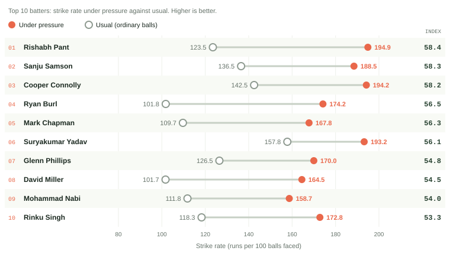
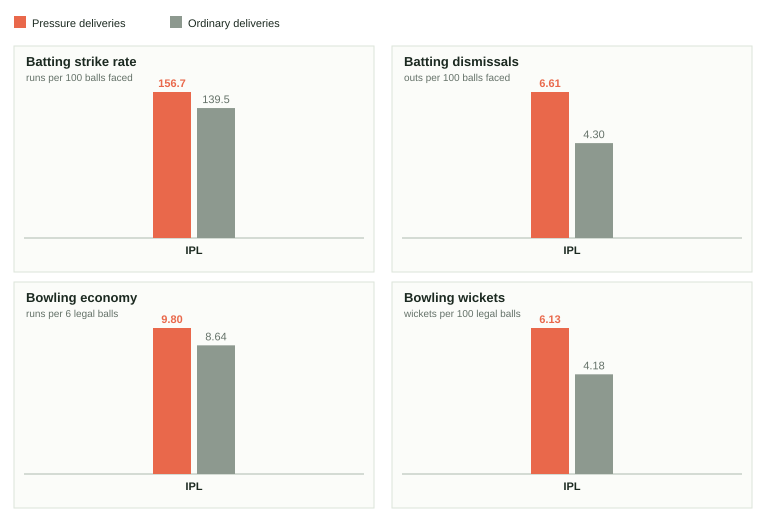
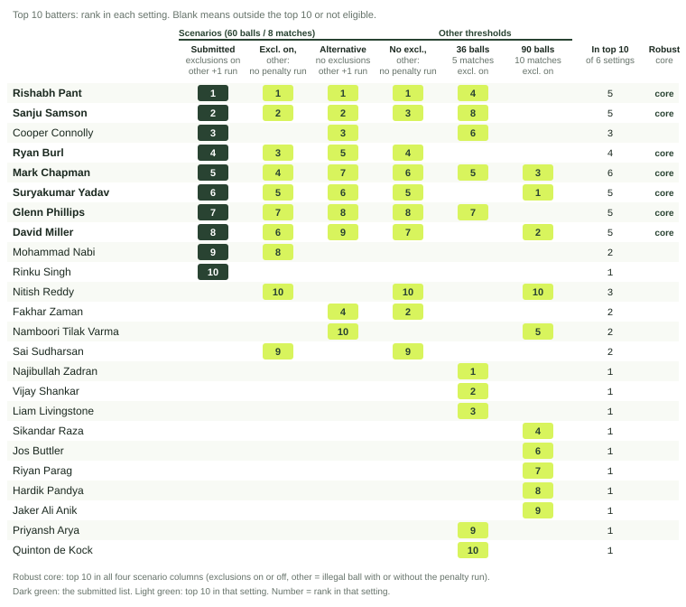
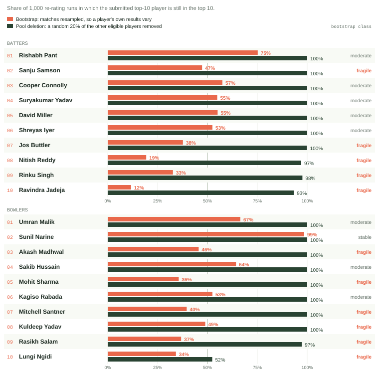

# SupeRR Selector Season 2
## Round 1 methodology: pressure performance index

**Analysis window:** supplied IPL and T20I data, seasons 2022–2026. The 2026 season may be incomplete.

## Executive result

This analysis defines pressure from the live innings state before a delivery, then compares each player's pressured performance with their ordinary performance. Scores are standardized within format-season pools, include match-to-match consistency, and are shrunk toward the field midpoint when evidence is limited. The dashboard recalculates these lists from the same shared scoring module.

**Exclusion policy.** The primary lists below exclude three groups of players before scoring: 53 players who appear for Pakistan in the supplied T20I data (Pakistan T20I team representation is the nationality proxy), five players with confirmed IPL playing retirements (Kieron Pollard, Dwayne Bravo, Ambati Rayudu, Dinesh Karthik, Ravichandran Ashwin), and Mohit Sharma. The cited IPL.com article says Mohit Sharma announced his retirement from all forms of cricket in December 2025 and is expected to become CSK's bowling coach for IPL 2027. The problem statement does not ask for any of these exclusions. The ranking with no exclusions is shown next to the primary lists in "Sensitivity and exclusions"; it replaces 2 of the ten batters and 3 of the ten bowlers. To rank without the exclusions, see "Flip the exclusions".

### Top 10 batters

| Rank | Player | Pressure index | Pressure SR | Usual SR | Pressure balls | Pressure matches | Positive-match share | Sample reliability |
|---:|---|---:|---:|---:|---:|---:|---:|---:|
| 1 | Rishabh Pant | 58.4 | 194.9 | 123.5 | 217 | 17 | 82% | 76% |
| 2 | Sanju Samson | 58.3 | 188.5 | 136.5 | 113 | 8 | 75% | 61% |
| 3 | Cooper Connolly | 58.2 | 194.2 | 142.5 | 120 | 8 | 100% | 62% |
| 4 | Ryan Burl | 56.5 | 174.2 | 101.8 | 120 | 9 | 67% | 63% |
| 5 | Mark Chapman | 56.3 | 167.8 | 109.7 | 311 | 20 | 85% | 80% |
| 6 | Suryakumar Yadav | 56.1 | 193.2 | 157.8 | 724 | 41 | 71% | 90% |
| 7 | Glenn Phillips | 54.8 | 170.0 | 126.5 | 237 | 17 | 76% | 77% |
| 8 | David Miller | 54.5 | 164.5 | 101.7 | 220 | 14 | 79% | 74% |
| 9 | Mohammad Nabi | 54.0 | 158.7 | 111.8 | 126 | 9 | 89% | 64% |
| 10 | Rinku Singh | 53.3 | 172.8 | 118.3 | 367 | 34 | 53% | 85% |

<!-- chart:batters_pressure_vs_usual_sr -->

*Figure 1. Top 10 batters, strike rate under pressure (orange) against usual strike rate (grey ring). Every value is printed; the same numbers are in the top 10 batters table.*
<!-- /chart:batters_pressure_vs_usual_sr -->

### Top 10 bowlers

| Rank | Player | Pressure index | Pressure econ/6 | Usual econ/6 | Pressure balls | Pressure matches | Positive-match share | Sample reliability |
|---:|---|---:|---:|---:|---:|---:|---:|---:|
| 1 | Akash Madhwal | 61.8 | 7.35 | 10.50 | 93 | 8 | 63% | 59% |
| 2 | Sunil Narine | 61.3 | 6.28 | 7.33 | 684 | 53 | 60% | 91% |
| 3 | Umran Malik | 61.3 | 6.43 | 10.06 | 97 | 9 | 56% | 61% |
| 4 | Washington Sundar | 60.6 | 5.56 | 6.32 | 136 | 12 | 67% | 68% |
| 5 | Sakib Hussain | 58.9 | 8.36 | 10.82 | 150 | 11 | 82% | 68% |
| 6 | Kuldeep Yadav | 58.3 | 7.21 | 8.33 | 634 | 51 | 51% | 90% |
| 7 | Mohammad Saifuddin | 57.8 | 6.85 | 8.44 | 71 | 8 | 88% | 56% |
| 8 | Adam Zampa | 57.7 | 7.85 | 8.89 | 418 | 30 | 67% | 85% |
| 9 | Rasikh Salam | 56.3 | 9.20 | 9.75 | 137 | 11 | 73% | 67% |
| 10 | Benjamin Lister | 56.3 | 8.23 | 9.07 | 78 | 9 | 78% | 58% |

<!-- chart:bowlers_pressure_vs_usual_economy -->

*Figure 2. Top 10 bowlers, economy under pressure (orange) against usual economy (grey ring). Lower is better, so a dot to the left of its ring is an improvement. Every value is printed; the same numbers are in the top 10 bowlers table.*
<!-- /chart:bowlers_pressure_vs_usual_economy -->

### Top 10 all-rounders

Players must independently meet the selected eligibility threshold as both a batter and a bowler. The composite index is the equal-weight mean of their two final indexes, each of which already includes its own sample-reliability adjustment.

| Rank | Player | Composite index | Batting index | Bowling index | Batting pressure balls | Bowling pressure balls | Batting matches | Bowling matches |
|---:|---|---:|---:|---:|---:|---:|---:|---:|
| 1 | Washington Sundar | 54.0 | 47.4 | 60.6 | 141 | 136 | 14 | 12 |
| 2 | Sikandar Raza | 52.5 | 50.5 | 54.5 | 119 | 96 | 12 | 9 |
| 3 | Ravindra Jadeja | 51.5 | 52.6 | 50.4 | 255 | 369 | 18 | 28 |
| 4 | Moeen Ali | 50.4 | 50.6 | 50.2 | 164 | 102 | 13 | 8 |
| 5 | Nitish Reddy | 49.9 | 53.0 | 46.8 | 108 | 173 | 11 | 18 |
| 6 | Cameron Green | 49.0 | 51.0 | 47.0 | 163 | 160 | 12 | 19 |
| 7 | Axar Patel | 48.4 | 42.8 | 54.0 | 197 | 681 | 19 | 55 |
| 8 | Sam Curran | 48.0 | 50.5 | 45.5 | 200 | 453 | 18 | 44 |
| 9 | Shivam Dube | 47.5 | 48.6 | 46.3 | 684 | 151 | 59 | 16 |
| 10 | Roston Chase | 46.1 | 40.2 | 52.0 | 186 | 62 | 19 | 8 |

## Data and scope

The calculation joins `ball_by_ball.csv` to `matches.csv` and `competitions.csv`. IPL is identified by the competition name; T20I is identified by the competition format. Other competitions carrying a generic T20 label and records with no readable season are excluded. A season label is read as its leading four-digit year, so a competition labelled `2022/23` belongs to season 2022. Super-over innings (innings 3 and 4) are skipped. The in-scope data contains **837 matches** and **193,988 deliveries**: **81,806 pressure** (42.2%) and **112,182 ordinary**. The supplied ball-by-ball file has 200,999 raw rows; the difference is excluded competitions, skipped super-over innings, or out-of-scope records, not missing rows. Only `ball_by_ball.csv`, `matches.csv` and `competitions.csv` are read by the analysis. `teams.csv`, `playing_eleven.csv` and `competition_team_player_mapping.csv` are not needed for the scores: team names come from `matches.csv`, and the ranking does not use line-ups. The data pack has no `players.csv`; player ids and names come from the ball-by-ball columns. As a cross-check, the mapping file lists 55 Pakistan T20I players for 2022 onward. 53 of them have in-scope deliveries, and these are the 53 excluded ids; the other two (ids 3083 and 47017) have none. All 20 ranked batters and bowlers appear in the mapping file with one id each, equal to the id in the ball-by-ball file.

Deliveries are processed in file order. The current delivery is classified first; only then are its score, wicket, and legal-ball effects applied to the innings state. Revised-overs fields greater than 20 are interpreted as legal-ball counts (for example, 114 means 19 overs); smaller nonzero values are treated as overs. Revised targets are used when present; otherwise the innings limit is 20 overs and the second-innings target is one more than the first-innings total. Wides, no-balls and the `other` extras type do not count as legal balls, and wides do not count as balls faced. Batter runs come from `runs`.

The extras columns are inconsistent: `extras1_runs` is 6 on ordinary deliveries and takes categorical-looking values on tagged extras. It is not treated as a run amount. For innings-state reconstruction and bowler conceded runs, the analyzer adds the known one-run penalty for identified wides and no-balls; these are tagged `wide`, `Overstep` and `other` in this dataset. The `other` type (264 rows) is not documented. It is treated as a no-ball because `extras1_runs` has the same code (5) on every one of its rows, batters score off it, and counting it as a legal ball would put seven or more legal balls in 243 of the 254 overs that contain such a row (all 216 of those that are not the last over of an innings), while counting it as illegal gives exactly six in each of them. The evidence and the alternative are in "The `other` extras assumption and the alternative top 10". Byes and leg-byes are not charged to bowlers. Because reliable run amounts for these extras are not present in the supplied fields, their runs are omitted from reconstructed chase totals. This makes chase required-rate pressure an approximation.

## Pressure definition

A delivery is pressure if **any** of these pre-delivery conditions is true. Overlaps count once.

1. **Finish phase:** at most 30 legal balls remain in the scheduled or revised innings.
2. **Wicket squeeze:** at least five wickets have fallen, at least 48 legal balls have elapsed, and at most 72 legal balls remain.
3. **Chase squeeze:** in the second innings, after at least 18 legal balls, the required rate is at least 9.5 runs per over; or it is at least 7.5 and exceeds the current rate by at least 2.5 runs per over.

The finish phase captures high-leverage deliveries in either innings. The wicket squeeze adds batting-resource scarcity. The chase squeeze responds to both target difficulty and progress instead of labelling every chase as pressured. These are explicit proxies, not direct measurements of psychological pressure. A first-innings closeness proxy is not inferred from the final result.

**Why these cutoffs.** They are fixed judgement calls, and no procedure in this project searched for them or tuned them against player results. Thirty balls is the last five overs of a 20-over innings (the same 30 balls remaining when the innings is shortened by revised overs). Five wickets is half of the batting side's wickets. 48 balls played and at most 72 remaining mean eight overs gone and twelve or fewer left; in a full 20-over innings those two conditions are the same (48 + 72 = 120), so they differ only in shortened innings. The required rate is read only after 18 balls (three overs) because it swings widely over the first few balls. A required rate of 9.5 is above what bowlers concede in this data (9.26 runs per over on pressure deliveries and 8.31 on ordinary ones), so a side that needs it must score faster than the usual rate. The second test, a required rate of at least 7.5 and at least 2.5 above the current rate, catches chases that fall behind a moderate target; 7.5 and 2.5 are round-number choices. The sensitivity section varies the sample thresholds, the exclusions and the `other` extras rule. It does not vary these pressure cutoffs, so how far the lists would move under different cutoffs has not been measured.

## Performance and ranking

Players who represented Pakistan in T20Is in the supplied data are excluded from the primary lists. The source has no dedicated nationality field, so Pakistan T20I team representation is used as the nationality proxy; 53 player IDs are excluded. Five players with confirmed IPL playing retirements are also excluded: Kieron Pollard, Dwayne Bravo, Ambati Rayudu, Dinesh Karthik, and Ravichandran Ashwin. Mohit Sharma is separately excluded: the cited IPL.com article reports that he announced his retirement from all forms of cricket in December 2025 and is expected to become CSK's bowling coach for IPL 2027. International-only retirements and unconfirmed rumors are not used. The problem statement does not require any of these exclusions, so the lists without them are reported under "Sensitivity and exclusions". These exclusions are applied before scoring and format-season standardization. Players are analyzed by format and season. A player-format-season segment must have at least **60 pressure balls**, **8 matches containing pressure batting/bowling**, and **60 ordinary balls**. After format-season roll-up, 60 batter profiles and 122 bowler profiles qualify; 11 players qualify in both disciplines for the all-rounder list. The dashboard also offers 36-ball/5-match and 90-ball/10-match sensitivity settings; their results are in "Sensitivity and exclusions".

Mohit Sharma's retirement and expected CSK coaching role: [IPL.com](https://www.ipl.com/cricket/news/mohit-sharma-to-join-csk-as-bowling-coach-for-ipl-2027-replaces-eric-simons/).

IPL retirement sources: [Mumbai Indians on Kieron Pollard](https://www.mumbaiindians.com/news/kieron-pollard-announces-retirement-from-playing-ipl-appointed-as-batting-coach-for-mumbai-indians); [ESPNcricinfo on Dwayne Bravo](https://www.espncricinfo.com/story/ipl-2023-csk-news-dwayne-bravo-retires-from-ipl-takes-over-as-chennai-super-kings-bowling-coach-1348125); [Cricbuzz on Ambati Rayudu](https://www.cricbuzz.com/cricket-news/126676/ambati-rayudu-to-retire-from-ipl-after-the-final); [ESPNcricinfo on Dinesh Karthik's last IPL season](https://www.espncricinfo.com/story/dinesh-karthik-retires-from-all-representative-cricket-1434318); [News18 on Ravichandran Ashwin](https://www.news18.com/cricket/ravichandran-ashwin-announces-retirement-from-ipl-9530890.html).

For batters the inputs are pressure strike rate, strike-rate change from the player's ordinary baseline, improvement in outs per 100 balls, and positive-match share. For bowlers they are lower pressure economy rate, economy improvement from the player's ordinary baseline, pressure wickets per 100 legal balls, and positive-match share. Inputs are direction-aligned and standardized as z-scores against eligible players in the same format-season pool. The weighted blend is:

`0.35 × output level + 0.30 × change vs own baseline + 0.20 × outcome + 0.15 × positive-match share`

Segment scores are combined for a player using pressure-ball volume as the weight. Sample reliability is:

`sqrt((pressure balls / (pressure balls + 60)) × (pressure matches / (pressure matches + 6)))`

The displayed index is `clip(50 + 10 × weighted raw rating × reliability, 0, 100)`. The unshrunk field midpoint is 50. Reliability is a heuristic shrinkage factor, not a statistical confidence interval.

All-rounders must qualify for both the batter and bowler lists under the same format, season, and sample filters. Their composite index is `0.50 × batting index + 0.50 × bowling index`. Since each component index is already reliability-adjusted, this averages the two final discipline indexes without giving either discipline extra weight. The dashboard displays both component indexes and sample sizes alongside the composite. This is a data-based dual-discipline ranking, not an official player-role classification.

For positive-match share, a batter's pressure segment is compared with their pooled ordinary rates. A match counts positive when `(pressure SR − usual SR) − 2 × (pressure outs/ball − usual outs/ball) > 0`. A bowler's match counts positive when `(usual economy − pressure economy) + 1.5 × (pressure wickets/100 balls − usual wickets/100 balls) > 0`. The share is the fraction of that player's pressure-exposed matches passing the test.

Bowler wicket credit excludes run-outs, retired hurt/out (including the source spelling `Retire Out`), timed out, handled-the-ball, and obstructing-the-field dismissals. Labels are normalized for spaces and spelling variations, including `RunOut` and the source typo `Obstracting the field`. A non-striker run-out is charged to that batter's dismissal rate but not given a faced ball.

## Evidence and interpretation

Rishabh Pant leads the batter list at 58.4, with 217 pressure balls in 17 matches, a 194.9 pressure strike rate versus 123.5 ordinarily, and a positive result in 82% of pressure matches. Sanju Samson and Cooper Connolly are within 0.2 index points of him. Suryakumar Yadav has the largest pressure sample in the batter top ten: 724 balls and 90% reliability.

Akash Madhwal leads the bowling index at 61.8, with a 7.35 pressure economy against 10.50 ordinarily over 93 balls in eight matches. Sunil Narine and Umran Malik follow at 61.3 each, and Narine ranks higher on pressure balls. Umran Malik's 6.43 pressure economy against 10.06 ordinarily comes from 97 balls in nine matches. Narine offers the strongest repeat-volume evidence in the top ten (684 pressure balls, 91% reliability), while his rating is 0.5 points below Madhwal's. The index therefore distinguishes rate performance from sample certainty.

### League-wide: pressure versus ordinary deliveries

The table sums every in-scope player-match record, including players who are excluded from the rankings or below the eligibility thresholds. Batting counts balls faced (wides excluded). Bowling counts legal balls. Economy is runs per six balls.

| Measure | All, pressure | All, ordinary | IPL, pressure | IPL, ordinary | T20I, pressure | T20I, ordinary |
|---|---:|---:|---:|---:|---:|---:|
| Batting strike rate | 148.1 | 134.2 | 156.7 | 139.5 | 140.6 | 129.9 |
| Batting outs per 100 balls | 7.06 | 4.58 | 6.61 | 4.30 | 7.45 | 4.80 |
| Bowling economy (runs per 6 balls) | 9.26 | 8.31 | 9.80 | 8.64 | 8.79 | 8.04 |
| Bowling wickets per 100 balls | 6.56 | 4.45 | 6.13 | 4.18 | 6.94 | 4.65 |
| Balls faced (batting records) | 78,112 | 108,404 | 36,115 | 48,006 | 41,997 | 60,398 |
| Balls bowled (bowling records) | 77,653 | 108,039 | 35,907 | 47,835 | 41,746 | 60,204 |

Across the in-scope data, batters score 148.1 runs per 100 balls under pressure against 134.2 otherwise, and are dismissed 7.06 times per 100 balls against 4.58. Bowlers concede 9.26 runs per over under pressure against 8.31, and take 6.56 wickets per 100 balls against 4.45. The direction is the same in IPL and T20I. These are raw league aggregates, not matched by player, opposition, or innings stage. The finish phase is part of the pressure definition, so faster scoring and more wickets late in an innings are expected. The table shows that the pressure rules select deliveries with different outcomes; it does not by itself validate the player index.

<!-- chart:league_pressure_vs_ordinary -->

*Figure 3. League-wide results on pressure and ordinary deliveries for every in-scope player-match record, all data and split by IPL and T20I. Values are printed above the bars and equal the league-wide table.*
<!-- /chart:league_pressure_vs_ordinary -->

## Sensitivity and exclusions

The lists depend on three choices that the problem statement or the data leave open: the player exclusions, the reading of the undocumented `other` extras type, and the sample thresholds. This section shows how much each one changes the result, which names stay in the top ten under every combination, and how fragile the places are that rest on small T20I pools. Nothing in this section changes the method or the submitted lists.

### Primary lists versus no exclusions

Default thresholds (60 pressure balls, 8 matches), after the pipeline fixes. The primary list excludes the players described in "Performance and ranking". The unfiltered list uses the same method with no player excluded. Eligible profiles (batters / bowlers / all-rounders) are 60 / 122 / 11 with exclusions and 66 / 136 / 12 without.

| Rank | Primary batters (exclusions on) | Index | Unfiltered batters (no exclusions) | Index |
|---:|---|---:|---|---:|
| 1 | Rishabh Pant | 58.4 | Rishabh Pant | 58.4 |
| 2 | Sanju Samson | 58.3 | Sanju Samson | 58.3 |
| 3 | Cooper Connolly | 58.2 | Cooper Connolly | 58.2 |
| 4 | Ryan Burl | 56.5 | Fakhar Zaman | 57.7 |
| 5 | Mark Chapman | 56.3 | Ryan Burl | 57.0 |
| 6 | Suryakumar Yadav | 56.1 | Suryakumar Yadav | 56.4 |
| 7 | Glenn Phillips | 54.8 | Mark Chapman | 56.0 |
| 8 | David Miller | 54.5 | Glenn Phillips | 54.5 |
| 9 | Mohammad Nabi | 54.0 | David Miller | 54.4 |
| 10 | Rinku Singh | 53.3 | Namboori Tilak Varma | 53.1 |

| Rank | Primary bowlers (exclusions on) | Index | Unfiltered bowlers (no exclusions) | Index |
|---:|---|---:|---|---:|
| 1 | Akash Madhwal | 61.8 | Umran Malik | 61.4 |
| 2 | Sunil Narine | 61.3 | Sunil Narine | 61.3 |
| 3 | Umran Malik | 61.3 | Mohammad Nawaz | 61.2 |
| 4 | Washington Sundar | 60.6 | Akash Madhwal | 60.9 |
| 5 | Sakib Hussain | 58.9 | Abrar Ahmed | 60.6 |
| 6 | Kuldeep Yadav | 58.3 | Washington Sundar | 59.7 |
| 7 | Mohammad Saifuddin | 57.8 | Sakib Hussain | 58.9 |
| 8 | Adam Zampa | 57.7 | Kuldeep Yadav | 58.2 |
| 9 | Rasikh Salam | 56.3 | Mohit Sharma | 58.0 |
| 10 | Benjamin Lister | 56.3 | Mohammad Saifuddin | 57.1 |

Without exclusions, Fakhar Zaman and Namboori Tilak Varma enter the batter top ten in place of Mohammad Nabi and Rinku Singh. In the bowler top ten, Mohammad Nawaz, Abrar Ahmed and Mohit Sharma enter in place of Adam Zampa, Rasikh Salam and Benjamin Lister.

### No-exclusion top 10 lists with full metrics

These are the top ten lists the method gives when none of the three exclusion groups is applied: the 53 Pakistan T20I players, the five IPL retirees and Mohit Sharma. Method, thresholds and columns are the same as in the submitted tables. The last column is the player's rank in the submitted list, or `excluded` for a player who is not ranked there. A player in both lists can have a slightly different index, because the format-season pools hold different players (Ryan Burl is 56.5 in the submitted list and 57.0 here). The same rows are in `sensitivity_data.json` under `noExclusion`.

**Batters (no exclusions)**

<!-- table:noexclusion_batters -->

| Rank | Player | Index | Pressure SR | Usual SR | Pressure balls | Pressure matches | Positive-match share | Sample reliability | Rank in submitted list |
|---|---|---:|---:|---:|---:|---:|---:|---:|---:|
| 1 | Rishabh Pant | 58.4 | 194.9 | 123.5 | 217 | 17 | 82% | 76% | 1 |
| 2 | Sanju Samson | 58.3 | 188.5 | 136.5 | 113 | 8 | 75% | 61% | 2 |
| 3 | Cooper Connolly | 58.2 | 194.2 | 142.5 | 120 | 8 | 100% | 62% | 3 |
| 4 | Fakhar Zaman | 57.7 | 183.6 | 134.1 | 116 | 8 | 100% | 61% | excluded |
| 5 | Ryan Burl | 57.0 | 174.2 | 101.8 | 120 | 9 | 67% | 63% | 4 |
| 6 | Suryakumar Yadav | 56.4 | 193.2 | 157.8 | 724 | 41 | 71% | 90% | 6 |
| 7 | Mark Chapman | 56.0 | 167.8 | 109.7 | 311 | 20 | 85% | 80% | 5 |
| 8 | Glenn Phillips | 54.5 | 170.0 | 126.5 | 237 | 17 | 76% | 77% | 7 |
| 9 | David Miller | 54.4 | 164.5 | 101.7 | 220 | 14 | 79% | 74% | 8 |
| 10 | Namboori Tilak Varma | 53.1 | 164.0 | 117.3 | 1048 | 77 | 65% | 94% | 11 |

<!-- /table:noexclusion_batters -->

**Bowlers (no exclusions)**

<!-- table:noexclusion_bowlers -->

| Rank | Player | Index | Pressure econ/6 | Usual econ/6 | Pressure balls | Pressure matches | Positive-match share | Sample reliability | Rank in submitted list |
|---|---|---:|---:|---:|---:|---:|---:|---:|---:|
| 1 | Umran Malik | 61.4 | 6.43 | 10.06 | 97 | 9 | 56% | 61% | 3 |
| 2 | Sunil Narine | 61.3 | 6.28 | 7.33 | 684 | 53 | 60% | 91% | 2 |
| 3 | Mohammad Nawaz | 61.2 | 5.39 | 7.40 | 186 | 15 | 73% | 73% | excluded |
| 4 | Akash Madhwal | 60.9 | 7.35 | 10.50 | 93 | 8 | 63% | 59% | 1 |
| 5 | Abrar Ahmed | 60.6 | 5.17 | 7.81 | 232 | 18 | 67% | 77% | excluded |
| 6 | Washington Sundar | 59.7 | 5.56 | 6.32 | 136 | 12 | 67% | 68% | 4 |
| 7 | Sakib Hussain | 58.9 | 8.36 | 10.82 | 150 | 11 | 82% | 68% | 5 |
| 8 | Kuldeep Yadav | 58.2 | 7.21 | 8.33 | 634 | 51 | 51% | 90% | 6 |
| 9 | Mohit Sharma | 58.0 | 9.29 | 9.82 | 345 | 23 | 78% | 82% | excluded |
| 10 | Mohammad Saifuddin | 57.1 | 6.85 | 8.44 | 71 | 8 | 88% | 56% | 7 |

<!-- /table:noexclusion_bowlers -->

### The `other` extras assumption and the alternative top 10

**Assumption used for the submitted lists.** A delivery with `extras_type = other` (264 rows in the supplied file) is read as a no-ball variant: it is not one of the six legal balls of an over, and the bowler is charged one penalty run, which also counts in the innings score used for the required rate. The data supports the first part and does not settle the second.

**Evidence.** `extras1_runs` is 5 on all 264 rows (wide is 2, `Overstep` is 1, ordinary balls 6). Batter runs are recorded on 136 of the 264 rows (26 sixes, 42 fours), against 337 of 576 `Overstep` rows and none of 7,714 wides. 254 overs contain an `other` row. Counted as a legal ball, 243 of them would hold more than six legal balls (all 216 of those that are not the last over of an innings); counted as an illegal ball, 243 hold exactly six (216 of 216). Overs with no `other` row hold exactly six legal balls in 30,406 of 30,410 finished overs. No column gives the value of the `other` extra: `runs` is the batter's runs on every extras type, so the one-run penalty is a rule-based assumption (a no-ball costs the bowler one run), not something read from the data. A run-margin check was inconclusive: among 11 comparable matches decided by runs and without an `other` row, the margin equals the difference between the innings totals in only 5. The one comparable match with an `other` row (India won by 61 runs) gives a difference of 61 with the penalty run and 60 without it, which favours the penalty run but is a single match.

**Alternative: illegal ball, no penalty run.** The `other` ball is still not a legal ball, but no run is charged to the bowler or added to the innings score. In the in-scope data this moves 70 deliveries from pressure to ordinary: pressure deliveries 81,806 to 81,736, ordinary 112,182 to 112,252. The submitted lists keep the penalty run. The tables below show exactly who moves, with exclusions on and everything else unchanged.

**Batters.** 59 players are eligible instead of 60. Cooper Connolly (3rd, 58.2, in the submitted list) is no longer eligible: he has 8 pressure matches with the penalty run and 7 without it, and the threshold is 8. Rinku Singh falls from 10th to 11th (53.5). Sai Sudharsan (9th, 53.8; 21st in the submitted list) and Nitish Reddy (10th, 53.6; 13th) enter. Eight names are shared. Rishabh Pant leads in both (59.2 against 58.4), Sanju Samson is second in both (57.8 against 58.3) and Ryan Burl rises to third.

**Bowlers.** The same ten names in the same order. Indexes change by at most 0.3 (Sunil Narine 61.3 to 61.6, Washington Sundar 60.6 to 60.9).

With the exclusions lifted as well (`otherAlternative.exclusionsOff` in `sensitivity_data.json`) the pattern is the same: Connolly drops out, Sudharsan and Reddy enter the batter list (Namboori Tilak Varma also leaves it), and the bowler names are unchanged. All four combinations appear in the robust core tables below.

**Batters (`other` = illegal ball, no penalty run; exclusions on)**

<!-- table:other_batters -->

| Rank | Player | Index | Pressure SR | Usual SR | Pressure balls | Pressure matches | Positive-match share | Sample reliability | Rank in submitted list |
|---|---|---:|---:|---:|---:|---:|---:|---:|---:|
| 1 | Rishabh Pant | 59.2 | 194.9 | 123.5 | 217 | 17 | 82% | 76% | 1 |
| 2 | Sanju Samson | 57.8 | 188.5 | 136.5 | 113 | 8 | 75% | 61% | 2 |
| 3 | Ryan Burl | 56.5 | 174.2 | 101.8 | 120 | 9 | 67% | 63% | 4 |
| 4 | Mark Chapman | 56.4 | 167.8 | 109.7 | 311 | 20 | 85% | 80% | 5 |
| 5 | Suryakumar Yadav | 56.1 | 193.2 | 157.8 | 724 | 41 | 71% | 90% | 6 |
| 6 | David Miller | 55.4 | 163.5 | 102.6 | 222 | 14 | 79% | 74% | 8 |
| 7 | Glenn Phillips | 54.9 | 170.0 | 126.5 | 237 | 17 | 76% | 77% | 7 |
| 8 | Mohammad Nabi | 54.3 | 158.7 | 111.8 | 126 | 9 | 89% | 64% | 9 |
| 9 | Sai Sudharsan | 53.8 | 183.5 | 147.6 | 249 | 17 | 71% | 77% | 21 |
| 10 | Nitish Reddy | 53.6 | 194.4 | 135.3 | 108 | 11 | 55% | 64% | 13 |

<!-- /table:other_batters -->

**Bowlers (`other` = illegal ball, no penalty run; exclusions on)**

<!-- table:other_bowlers -->

| Rank | Player | Index | Pressure econ/6 | Usual econ/6 | Pressure balls | Pressure matches | Positive-match share | Sample reliability | Rank in submitted list |
|---|---|---:|---:|---:|---:|---:|---:|---:|---:|
| 1 | Akash Madhwal | 62.0 | 7.29 | 10.50 | 93 | 8 | 63% | 59% | 1 |
| 2 | Sunil Narine | 61.6 | 6.24 | 7.37 | 683 | 53 | 62% | 91% | 2 |
| 3 | Umran Malik | 61.5 | 6.31 | 10.03 | 97 | 9 | 56% | 61% | 3 |
| 4 | Washington Sundar | 60.9 | 5.56 | 6.32 | 135 | 12 | 75% | 68% | 4 |
| 5 | Sakib Hussain | 59.0 | 8.32 | 10.82 | 150 | 11 | 82% | 68% | 5 |
| 6 | Kuldeep Yadav | 58.4 | 7.21 | 8.33 | 634 | 51 | 51% | 90% | 6 |
| 7 | Mohammad Saifuddin | 57.8 | 6.85 | 8.44 | 71 | 8 | 88% | 56% | 7 |
| 8 | Adam Zampa | 57.5 | 7.88 | 8.86 | 416 | 30 | 67% | 85% | 8 |
| 9 | Rasikh Salam | 56.2 | 9.20 | 9.75 | 137 | 11 | 73% | 67% | 9 |
| 10 | Benjamin Lister | 56.2 | 8.23 | 9.07 | 78 | 9 | 78% | 58% | 10 |

<!-- /table:other_bowlers -->

### Robust core: names that stay in the top ten

A player is in the robust core if he is in the top ten under all four combinations of two choices at the default 60 balls / 8 matches: player exclusions on or off, and the `other` extras type with or without the penalty run. Each table lists every player who reaches the top ten in at least one combination, with his rank in each. A dash means outside the top ten or not eligible. Figures 4 and 5 add two threshold settings (36 balls / 5 matches and 90 balls / 10 matches, exclusions on) for the same players.

**Batters in the robust core (7):** Rishabh Pant, Sanju Samson, Ryan Burl, Mark Chapman, Suryakumar Yadav, Glenn Phillips and David Miller. Three submitted batters are not in the core: Cooper Connolly (3rd with the penalty run, not eligible without it), Mohammad Nabi (outside the top ten once exclusions are lifted) and Rinku Singh (in the top ten only in the submitted list).

**Bowlers in the robust core (7):** Akash Madhwal, Sunil Narine, Umran Malik, Washington Sundar, Sakib Hussain, Kuldeep Yadav and Mohammad Saifuddin. Adam Zampa, Rasikh Salam and Benjamin Lister are in the top ten only with exclusions on; the `other` rule does not move them.

**Batters**

<!-- table:robust_batters -->

| Player | Submitted list | other: no penalty run | No exclusions | No exclusions, no penalty run | Top 10 in | Robust core |
|---|---:|---:|---:|---:|---:|---:|
| Rishabh Pant | 1 | 1 | 1 | 1 | 4 of 4 | core |
| Sanju Samson | 2 | 2 | 2 | 3 | 4 of 4 | core |
| Ryan Burl | 4 | 3 | 5 | 4 | 4 of 4 | core |
| Mark Chapman | 5 | 4 | 7 | 6 | 4 of 4 | core |
| Suryakumar Yadav | 6 | 5 | 6 | 5 | 4 of 4 | core |
| Glenn Phillips | 7 | 7 | 8 | 8 | 4 of 4 | core |
| David Miller | 8 | 6 | 9 | 7 | 4 of 4 | core |
| Cooper Connolly | 3 | - | 3 | - | 2 of 4 |  |
| Mohammad Nabi | 9 | 8 | - | - | 2 of 4 |  |
| Fakhar Zaman | - | - | 4 | 2 | 2 of 4 |  |
| Sai Sudharsan | - | 9 | - | 9 | 2 of 4 |  |
| Nitish Reddy | - | 10 | - | 10 | 2 of 4 |  |
| Rinku Singh | 10 | - | - | - | 1 of 4 |  |
| Namboori Tilak Varma | - | - | 10 | - | 1 of 4 |  |

<!-- /table:robust_batters -->

<!-- chart:sensitivity_top10_batters -->

*Figure 4. Top-10 batters across six settings. The first four columns are the robust-core test (player exclusions on or off, and the "other" extras type with or without the penalty run). The last two columns change the sample thresholds with exclusions on.*
<!-- /chart:sensitivity_top10_batters -->

**Bowlers**

<!-- table:robust_bowlers -->

| Player | Submitted list | other: no penalty run | No exclusions | No exclusions, no penalty run | Top 10 in | Robust core |
|---|---:|---:|---:|---:|---:|---:|
| Akash Madhwal | 1 | 1 | 4 | 4 | 4 of 4 | core |
| Sunil Narine | 2 | 2 | 2 | 1 | 4 of 4 | core |
| Umran Malik | 3 | 3 | 1 | 2 | 4 of 4 | core |
| Washington Sundar | 4 | 4 | 6 | 6 | 4 of 4 | core |
| Sakib Hussain | 5 | 5 | 7 | 7 | 4 of 4 | core |
| Kuldeep Yadav | 6 | 6 | 8 | 8 | 4 of 4 | core |
| Mohammad Saifuddin | 7 | 7 | 10 | 10 | 4 of 4 | core |
| Adam Zampa | 8 | 8 | - | - | 2 of 4 |  |
| Rasikh Salam | 9 | 9 | - | - | 2 of 4 |  |
| Benjamin Lister | 10 | 10 | - | - | 2 of 4 |  |
| Mohammad Nawaz | - | - | 3 | 3 | 2 of 4 |  |
| Abrar Ahmed | - | - | 5 | 5 | 2 of 4 |  |
| Mohit Sharma | - | - | 9 | 9 | 2 of 4 |  |

<!-- /table:robust_bowlers -->

<!-- chart:sensitivity_top10_bowlers -->

*Figure 5. Top-10 bowlers across the same six settings as Figure 4.*
<!-- /chart:sensitivity_top10_bowlers -->

### Small T20I pools

Players are standardised (z-scores) only against the other eligible players of the same format and season. The table shows how many players each pool holds with exclusions on at 60 balls / 8 matches. Five of the ten batter pools hold 10 or fewer players, and all five are T20I seasons: 2022 (10), 2023 (5), 2024 (10), 2025 (10) and 2026 (6). The IPL batter pools hold 12 to 17. The bowler pools are larger: 12 to 36 in T20I and 31 to 36 in IPL, and none holds 10 or fewer. A z-score taken inside a pool of five to ten players moves a lot when one player is added or removed, so a batter whose index rests on those pools is less certain than the same index from an IPL pool.

<!-- table:pool_sizes -->

| Pool | Eligible batters | Median pressure balls per batter | Batter pool thin | Eligible bowlers | Median pressure balls per bowler |
|---|---:|---:|---:|---:|---:|
| IPL:2022 | 16 | 119 | no | 34 | 126 |
| IPL:2023 | 13 | 120 | no | 33 | 120 |
| IPL:2024 | 12 | 117 | no | 31 | 115 |
| IPL:2025 | 17 | 116 | no | 36 | 122.5 |
| IPL:2026 | 12 | 120.5 | no | 32 | 123 |
| T20I:2022 | 10 | 148.5 | thin (10 or fewer) | 36 | 112 |
| T20I:2023 | 5 | 124 | thin (10 or fewer) | 12 | 100 |
| T20I:2024 | 10 | 114 | thin (10 or fewer) | 22 | 123 |
| T20I:2025 | 10 | 128.5 | thin (10 or fewer) | 32 | 102 |
| T20I:2026 | 6 | 100 | thin (10 or fewer) | 12 | 103 |

<!-- /table:pool_sizes -->

**Who depends on the thin pools.** All of the pressure balls of four submitted batters come from the thin T20I pools: Ryan Burl, Mark Chapman, Glenn Phillips and Mohammad Nabi. For Suryakumar Yadav the share is 52% and for Rinku Singh 24%. Rishabh Pant, Sanju Samson, Cooper Connolly and David Miller have none there. Washington Sundar, Mohammad Saifuddin, Adam Zampa and Benjamin Lister get all their pressure balls from T20I seasons, but the bowler pools hold 12 to 36 players.

**Re-rating tests.** Each test re-rates every player with `scoring.mjs` on changed data (fixed seed; details in `sensitivity_data.json`, `rankStability`). Leave-one-out removes one other eligible player of the same kind at a time. Pool deletion removes a random 20% of the eligible players who are not in the submitted top ten, 1,000 times, so it changes only who is in the pools. The bootstrap resamples each player's match records, 1,000 times, so it also moves the player's own results. The tables give the share of runs in which a submitted player is still in the top ten. The class is fragile below 50%, moderate from 50% to under 80% and stable at 80% or more, using the unrounded share (Kuldeep Yadav at 49.8% is shown as 50% and is fragile).

- The make-up of the pools alone moves little. Under pool deletion every submitted player except Rinku Singh stays in the top ten in at least 81% of runs.
- **Rinku Singh (10th, 53.3) is the weakest place.** He is in the top ten in 44% of pool-deletion runs and 24% of bootstrap runs, and he leaves the top ten in 8 of the 59 leave-one-out runs (worst rank 13th).
- **Mohammad Nabi (9th, 54.0)** is in the top ten in 20% of bootstrap runs and 83% of pool-deletion runs; all of his pressure balls come from a T20I pool of 10 players.
- **Rasikh Salam (9th, 56.3) and Benjamin Lister (10th, 56.3)** are the weakest bowler places: 17% and 20% of bootstrap runs, 81% and 82% of pool-deletion runs. Lister leaves the top ten in 1 of 121 leave-one-out runs.
- The bootstrap is wider than pool deletion because the samples are small (71 to 724 pressure balls for the submitted players). Only Sunil Narine (97%) is stable by that rule; 11 of the 20 submitted players are fragile (Samson, Burl, Phillips, Miller, Nabi and Rinku Singh among the batters; Madhwal, Kuldeep Yadav, Saifuddin, Salam and Lister among the bowlers). The order inside the top ten is an estimate, not a statistically settled ranking.

**Batters: how fragile is each place**

<!-- table:fragility_batters -->

| Rank | Player | Index | Pressure balls in T20I pools | Smallest pool (players) | Worst rank, one other player removed | In top 10, bootstrap | In top 10, pool deletion | Class: bootstrap / pool deletion |
|---|---|---:|---:|---:|---:|---:|---:|---:|
| 1 | Rishabh Pant | 58.4 | 0% | 12 | 2 | 61% | 100% | moderate / stable |
| 2 | Sanju Samson | 58.3 | 0% | 12 | 3 | 32% | 100% | fragile / stable |
| 3 | Cooper Connolly | 58.2 | 0% | 12 | 4 | 51% | 100% | moderate / stable |
| 4 | Ryan Burl | 56.5 | 100% | 10 | 6 | 46% | 100% | fragile / stable |
| 5 | Mark Chapman | 56.3 | 100% | 5 | 6 | 66% | 100% | moderate / stable |
| 6 | Suryakumar Yadav | 56.1 | 52% | 5 | 6 | 60% | 100% | moderate / stable |
| 7 | Glenn Phillips | 54.8 | 100% | 10 | 8 | 46% | 97% | fragile / stable |
| 8 | David Miller | 54.5 | 0% | 16 | 9 | 38% | 97% | fragile / stable |
| 9 | Mohammad Nabi | 54.0 | 100% | 10 | 10 | 20% | 83% | fragile / stable |
| 10 | Rinku Singh | 53.3 | 24% | 10 | 13 (out in 8 of 59) | 24% | 44% | fragile / fragile |

<!-- /table:fragility_batters -->

**Bowlers: how fragile is each place**

<!-- table:fragility_bowlers -->

| Rank | Player | Index | Pressure balls in T20I pools | Smallest pool (players) | Worst rank, one other player removed | In top 10, bootstrap | In top 10, pool deletion | Class: bootstrap / pool deletion |
|---|---|---:|---:|---:|---:|---:|---:|---:|
| 1 | Akash Madhwal | 61.8 | 0% | 33 | 2 | 43% | 100% | fragile / stable |
| 2 | Sunil Narine | 61.3 | 0% | 31 | 3 | 97% | 100% | stable / stable |
| 3 | Umran Malik | 61.3 | 0% | 34 | 3 | 62% | 100% | moderate / stable |
| 4 | Washington Sundar | 60.6 | 100% | 22 | 4 | 52% | 100% | moderate / stable |
| 5 | Sakib Hussain | 58.9 | 0% | 32 | 5 | 55% | 100% | moderate / stable |
| 6 | Kuldeep Yadav | 58.3 | 14% | 31 | 6 | 50% | 100% | fragile / stable |
| 7 | Mohammad Saifuddin | 57.8 | 100% | 32 | 8 | 43% | 100% | fragile / stable |
| 8 | Adam Zampa | 57.7 | 100% | 22 | 8 | 51% | 100% | moderate / stable |
| 9 | Rasikh Salam | 56.3 | 0% | 32 | 10 | 17% | 81% | fragile / stable |
| 10 | Benjamin Lister | 56.3 | 100% | 12 | 11 (out in 1 of 121) | 20% | 82% | fragile / stable |

<!-- /table:fragility_bowlers -->

<!-- chart:rank_stability -->

*Figure 6. Share of 1,000 bootstrap runs and 1,000 pool-deletion runs in which each submitted top-10 player stays in the top 10 (sensitivity_data.json, rankStability). The label at the right is the bootstrap fragility class: below 50% fragile, 50% to under 80% moderate, 80% or more stable.*
<!-- /chart:rank_stability -->

**If the thin pools are not used.** Each test below is sensitivity only; the submitted lists are unchanged.

- Dropping every pool with fewer than 11 eligible players removes all five T20I batter pools. Ryan Burl, Mark Chapman, Glenn Phillips and Mohammad Nabi are then not eligible, and Shreyas Iyer (6th, 54.4), Jos Buttler (7th, 53.0), Nitish Reddy (8th, 53.0) and Ravindra Jadeja (10th, 52.6) enter. 6 of the 10 batter names are shared and the bowler list is unchanged. Dropping only the pools with fewer than 8 players (T20I 2023 and 2026) replaces Rinku Singh by Shreyas Iyer (9th, 54.4).
- Sharing one pool across the five T20I seasons keeps every player's own data and eligibility and changes only the pool the z-scores are taken against. Eight batter names stay: Mohammad Nabi falls to 11th (52.9) and Rinku Singh to 12th (52.8), and Jos Buttler (9th, 53.0) and Nitish Reddy (10th, 53.0) enter. Among bowlers, Benjamin Lister falls to 14th and Varun Chakravarthy enters in 9th (56.5). Sharing one pool across all seasons of each format gives the same entrants; Rinku Singh falls to 15th.
- Merging each player's seasons into one career profile per format changes who is eligible (113 batters and 180 bowlers with the T20I seasons merged, 144 and 197 with all seasons merged) and keeps only 4 of 10 batter names and 6 of 10 bowler names (2 and 3 when all seasons are merged). It mixes the pool-size effect with a change in eligibility, so it is not a clean test; the lists are in `sensitivity_data.json` under `poolingSeasons.careerPooled`.

<!-- table:pool_variants -->

| Setting | Eligible bat / bowl | Top-10 names shared, bat / bowl | Batters in | Batters out | Bowlers in | Bowlers out |
|---|---:|---:|---|---|---|---|
| Drop pools with fewer than 8 eligible players (2 pools dropped) | 58 / 122 | 9 / 10 | Shreyas Iyer (9, was 14) | Rinku Singh (was 10, now 11) | none | none |
| Drop pools with fewer than 11 eligible players (5 pools dropped) | 41 / 122 | 6 / 10 | Shreyas Iyer (6, was 14); Jos Buttler (7, was 12); Nitish Reddy (8, was 13); Ravindra Jadeja (10, was 15) | Ryan Burl (was 4, now not eligible); Mark Chapman (was 5, now not eligible); Glenn Phillips (was 7, now not eligible); Mohammad Nabi (was 9, now not eligible) | none | none |
| Drop pools with fewer than 13 eligible players (9 pools dropped) | 34 / 117 | 4 / 9 | Sam Curran (2, was 27); Shreyas Iyer (3, was 14); Jos Buttler (5, was 12); Sai Sudharsan (8, was 21); Riyan Parag (9, was 19); Heinrich Klaasen (10, was 26) | Sanju Samson (was 2, now not eligible); Cooper Connolly (was 3, now not eligible); Ryan Burl (was 4, now not eligible); Mark Chapman (was 5, now not eligible); Glenn Phillips (was 7, now not eligible); Mohammad Nabi (was 9, now not eligible) | Varun Chakravarthy (10, was 11) | Benjamin Lister (was 10, now not eligible) |
| Standardise against a shared pool: T20I seasons pooled, IPL seasons kept apart | 60 / 122 | 8 / 9 | Jos Buttler (9, was 12); Nitish Reddy (10, was 13) | Mohammad Nabi (was 9, now 11); Rinku Singh (was 10, now 12) | Varun Chakravarthy (9, was 11) | Benjamin Lister (was 10, now 14) |
| Standardise against a shared pool: all seasons pooled within each format | 60 / 122 | 8 / 9 | Jos Buttler (9, was 12); Nitish Reddy (10, was 13) | Mohammad Nabi (was 9, now 11); Rinku Singh (was 10, now 15) | Varun Chakravarthy (9, was 11) | Benjamin Lister (was 10, now 13) |

<!-- /table:pool_variants -->

**Finding.** Thin T20I batter pools make the places of Ryan Burl (4th), Mark Chapman (5th), Glenn Phillips (7th), Mohammad Nabi (9th) and, to a smaller degree, Rinku Singh (10th) less certain than their indexes suggest. Rishabh Pant, Sanju Samson, Cooper Connolly and David Miller are not exposed to this. No bowler pool is thin; the bowler places at 9 and 10 are fragile because of small samples. The method and the submitted lists were not changed on this basis.

### Thresholds, exclusions, and the pipeline fixes

Each row applies the same scoring to the analysis data before the pipeline fixes (819 matches: season labels such as `2022/23` were dropped, `other` extras counted as legal balls, `Retire Out` credited to bowlers) and after them (this report, 837 matches). The last column counts how many of a row's top ten names also appear in the 60/8 top ten of the same data version and exclusion setting.

| Setting | Exclusions | Data | Eligible bat / bowl / AR | Top 3 batters (index) | Top 3 bowlers (index) | Top-10 names shared with default list, bat / bowl |
|---|---|---|---:|---|---|---:|
| 60 balls / 8 matches (default) | On | Before fixes | 57 / 122 / 11 | Rishabh Pant 59.3; Sanju Samson 57.8; Ryan Burl 56.5 | Akash Madhwal 62.8; Sunil Narine 61.7; Umran Malik 61.6 | 10 / 10 |
| 60 balls / 8 matches (default) | On | After fixes | 60 / 122 / 11 | Rishabh Pant 58.4; Sanju Samson 58.3; Cooper Connolly 58.2 | Akash Madhwal 61.8; Sunil Narine 61.3; Umran Malik 61.3 | 10 / 10 |
| 60 balls / 8 matches (default) | Off | Before fixes | 61 / 134 / 12 | Rishabh Pant 59.3; Fakhar Zaman 59.3; Sanju Samson 57.8 | Akash Madhwal 61.9; Umran Malik 61.7; Sunil Narine 61.6 | 10 / 10 |
| 60 balls / 8 matches (default) | Off | After fixes | 66 / 136 / 12 | Rishabh Pant 58.4; Sanju Samson 58.3; Cooper Connolly 58.2 | Umran Malik 61.4; Sunil Narine 61.3; Mohammad Nawaz 61.2 | 10 / 10 |
| 36 balls / 5 matches | On | Before fixes | 109 / 178 / 16 | Najibullah Zadran 60.9; Vijay Shankar 60.6; Liam Livingstone 59.0 | Akash Madhwal 62.2; Sunil Narine 61.7; Sakib Hussain 58.8 | 3 / 6 |
| 36 balls / 5 matches | On | After fixes | 108 / 181 / 16 | Najibullah Zadran 60.5; Vijay Shankar 60.4; Liam Livingstone 58.9 | Akash Madhwal 61.4; Sunil Narine 61.2; Sakib Hussain 58.5 | 5 / 6 |
| 36 balls / 5 matches | Off | Before fixes | 118 / 194 / 17 | Najibullah Zadran 61.2; Vijay Shankar 60.6; Liam Livingstone 59.2 | Sunil Narine 61.7; Akash Madhwal 61.7; Mohammad Nawaz 61.2 | 4 / 6 |
| 36 balls / 5 matches | Off | After fixes | 118 / 198 / 17 | Najibullah Zadran 60.5; Vijay Shankar 60.4; Fakhar Zaman 59.3 | Mohammad Nawaz 61.4; Sunil Narine 61.3; Akash Madhwal 60.8 | 6 / 7 |
| 90 balls / 10 matches | On | Before fixes | 33 / 81 / 5 | Suryakumar Yadav 58.4; David Miller 57.5; Mark Chapman 57.3 | Sunil Narine 61.8; Sakib Hussain 58.6; Washington Sundar 58.5 | 4 / 4 |
| 90 balls / 10 matches | On | After fixes | 35 / 81 / 4 | Suryakumar Yadav 62.0; David Miller 58.6; Mark Chapman 57.3 | Sunil Narine 61.4; Washington Sundar 60.0; Sakib Hussain 58.3 | 3 / 3 |
| 90 balls / 10 matches | Off | Before fixes | 34 / 91 / 5 | Suryakumar Yadav 58.4; David Miller 57.5; Mark Chapman 57.3 | Mohammad Nawaz 62.5; Sunil Narine 61.9; Abrar Ahmed 61.0 | 4 / 7 |
| 90 balls / 10 matches | Off | After fixes | 37 / 91 / 4 | Suryakumar Yadav 62.5; David Miller 58.6; Mark Chapman 57.3 | Mohammad Nawaz 62.5; Sunil Narine 61.4; Abrar Ahmed 61.0 | 4 / 6 |

- With exclusions on and the fixes applied, 5 of the default top ten batters and 6 of the default top ten bowlers remain in the top ten at 36 balls / 5 matches. At 90 balls / 10 matches the counts are 3 and 3.
- Sunil Narine is in the top three bowlers and Sakib Hussain in the top five at all three threshold settings. Akash Madhwal leads at 60/8 and 36/5 but cannot qualify at 90/10, because he has 8 pressure matches and that setting requires 10.
- At the default setting the fixes bring Cooper Connolly and Glenn Phillips into the batter list and Rasikh Salam into the bowler list, and remove Sai Sudharsan and Nitish Reddy from the batter list and Kagiso Rabada from the bowler list.

## Flip the exclusions (optional, not part of the submitted ranking)

**Marked section: an option for the submitter, not part of the submitted ranking.** The submitted lists exclude the 53 Pakistan T20I players, five IPL retirees and Mohit Sharma. The complete no-exclusion lists with full metrics are in "No-exclusion top 10 lists with full metrics". To rank without the exclusions:

1. In `scoring.mjs` (line 6) change `const APPLY_PLAYER_EXCLUSIONS = true;` to `const APPLY_PLAYER_EXCLUSIONS = false;`. This is the only code change. `analysis_data.json` is not regenerated, because the exclusions are applied in `scoring.mjs`, not in `analyze.mjs`. The dashboard imports `scoring.mjs`, so it shows the no-exclusion lists at once.
2. Regenerate the numbers: `node sensitivity.mjs --print-top10` prints the top ten lists that `scoring.mjs` now gives. They equal the no-exclusion tables above. `sensitivity.mjs` checks this edit against `noExclusion` in `sensitivity_data.json` each time it runs.
3. Refresh the report: move the no-exclusion tables into the top 10 section, change the exclusion text in this report, `README.md` and `index.html` (method step 06), and print the PDF again with the command under "Reproduction". While the line says `false`, `node sensitivity.mjs` and `node charts.mjs` stop with an error, because they describe the submitted lists; set it back to `true` before running them.
4. Enter the no-exclusion names in the Unstop dropdowns. Batters: 1 Rishabh Pant, 2 Sanju Samson, 3 Cooper Connolly, 4 Fakhar Zaman, 5 Ryan Burl, 6 Suryakumar Yadav, 7 Mark Chapman, 8 Glenn Phillips, 9 David Miller, 10 Namboori Tilak Varma. Bowlers: 1 Umran Malik, 2 Sunil Narine, 3 Mohammad Nawaz, 4 Akash Madhwal, 5 Abrar Ahmed, 6 Washington Sundar, 7 Sakib Hussain, 8 Kuldeep Yadav, 9 Mohit Sharma, 10 Mohammad Saifuddin.
5. To go back to the submitted lists, set the line to `true` again.

## Reliability and limitations

- Sample filters and shrinkage reduce, but do not eliminate, small-sample and selection effects. The displayed reliability is not a confidence interval.
- Format-season standardization helps separate scoring environments, but IPL and T20I roles and opposition quality are not fully interchangeable. Only strata meeting eligibility contribute to a player's roll-up.
- Player indexes are not adjusted for opposition, venue or batting position, so differences in match context between players are not removed.
- The pressure rules can miss rivalry, knockout stakes, crowd conditions, or a close first-innings contest. Rankings are not causal estimates of a psychological trait.
- Run-outs are not credited as bowler wickets. Batter runs use `runs`; boundary flags disagree with that value on 23 deliveries, so flags are not used. Missing bye/leg-bye run amounts make chase totals approximate.
- Revised targets/overs are used when present, but supplied fields do not support full Duckworth-Lewis par scores or ball-level win probability.
- Scores are rounded to one decimal before ranking, so adjacent players can be very close. Players with the same rounded index are ordered by pressure balls, then by name (all-rounders: by the lower of their two component indexes, then by name). The tied pairs in the submitted lists are Sunil Narine and Umran Malik (61.3 each; Narine has 684 pressure balls against 97) and Rasikh Salam and Benjamin Lister (56.3 each; 137 against 78). Ordering by the unrounded index gives the same order.
- Small T20I pools: with exclusions on and the default thresholds, T20I format-season pools hold 5 to 10 eligible batters (12 to 17 in IPL seasons) and 12 to 36 eligible bowlers (31 to 36 in IPL seasons). Ryan Burl, Mark Chapman, Glenn Phillips and Mohammad Nabi get all of their pressure balls from the thin batter pools. Their places are fragile: with pools of fewer than 11 players dropped, none of the four is eligible, and Rinku Singh (10th) is in the top ten in 44% of pool-deletion runs. The numbers are in "Small T20I pools". The method and the submitted lists were not changed on this basis.
- Season labels: competitions labelled `2022/23`, `2023/24` and `2024/25` (18 matches) are assigned to their first calendar year. Series that run across two calendar years are pooled with that year's other competitions in the format-season z-scores. An earlier version of this analysis dropped these 18 matches; the "Before fixes" rows in the sensitivity table show the effect.
- The `other` extras type (264 rows) is undocumented. Treating it as a no-ball, with a one-run penalty charged to the bowler, is an inference from the data, not from documentation. The penalty run matters for the batter list: it adds 70 pressure deliveries and lifts Cooper Connolly over the 8-match threshold (8 pressure matches with it, 7 without it). The alternative (illegal ball, no penalty run) replaces Connolly and Rinku Singh by Sai Sudharsan and Nitish Reddy and leaves the bowler names unchanged; both lists are in "The `other` extras assumption and the alternative top 10".
- Super overs: innings 3 and 4 (38 rows in six matches, 26 rows in the four matches that are in scope) are skipped. Their balls are neither pressure nor ordinary. Treating every super-over ball as pressure would be a defensible alternative and was not applied.
- The player exclusions are a selection decision, not a feature of the method. Every list that shows the effect of removing them is in "Sensitivity and exclusions".

## Reproduction

Use Node.js 20 LTS (`package.json` declares Node 18 or newer; the committed `analysis_data.json` was generated with Node 20). From the data folder, with `ball_by_ball.csv`, `matches.csv` and `competitions.csv` present, run `node analyze.mjs` to regenerate `analysis_data.json` (only needed if the CSV files or the pressure rules change). `node sensitivity.mjs` (about five minutes) rewrites `sensitivity_data.json`. `node charts.mjs` redraws `charts/*.svg` and refreshes the figures and the sensitivity tables in this report's md and html from `analysis_data.json` and `sensitivity_data.json`; `node charts.mjs --check` compares without writing. The PDF is the html printed with headless Edge: `msedge --headless --disable-gpu --no-pdf-header-footer --print-to-pdf=methodology_report.pdf file:///<folder>/methodology_report.html`. The dashboard and ranked lists use `scoring.mjs`. Run `node server.mjs` and open `http://127.0.0.1:4173`. Filters recalculate rankings. **Export rankings** downloads one CSV with the current top ten batters, bowlers, and all-rounders for the selected filters.
