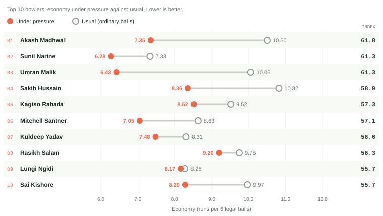
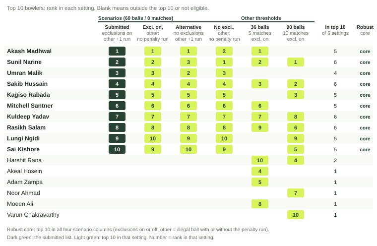

# SupeRR Selector Season 2
## Round 1 methodology: pressure performance index (IPL)

**Analysis window:** supplied IPL ball-by-ball data, seasons 2022–2026. The 2026 season may be incomplete. This report covers the top 10 batters and the top 10 bowlers in the IPL only. Every table, figure and number in the rankings and the analysis below is computed from IPL deliveries.

## Executive result

This analysis defines pressure from the live innings state before a delivery, then compares each player's pressured performance with their ordinary performance. Scores are standardized within season pools, include match-to-match consistency, and are shrunk toward the field midpoint when evidence is limited. The dashboard recalculates these lists from the same shared scoring module; its Format menu opens on IPL, so it shows the lists in this report by default.

**What the index measures.** The pressure index measures how much a player improves over his own usual level when the innings tightens. It does not measure how good his play under pressure is in absolute terms. A player whose usual level is already high has less room to improve, so he can rank below a player who is weaker overall but improves more. The subsection "Why a high usual level can rank lower" explains this in general terms and works through one example from the batter list.

**Exclusion policy.** The submitted lists exclude six players with confirmed IPL playing retirements before scoring: Kieron Pollard, Dwayne Bravo, Ambati Rayudu, Dinesh Karthik, Ravichandran Ashwin and Mohit Sharma. The problem statement does not ask for these exclusions. The scoring module also excludes a group of Pakistan T20I players; none of them has an IPL record, so that rule has no effect on the IPL lists. The ranking with no exclusions is shown as an alternative, with the same metrics, in "Sensitivity and exclusions": it adds back the first five retirees, and Mohit Sharma stays excluded in every list in this report. To rank without the exclusions, see "Switch the exclusions off".

**Outside this report.** The dashboard also ranks all-rounders and carries the Royal Radar and Raw Talent material. Neither is part of this report or of the Round 1 submission.

### Top 10 batters

<!-- table:top_batters -->

| Rank | Player | Pressure index | Pressure SR | Usual SR | Pressure balls | Pressure matches | Positive-match share | Sample reliability |
|---|---|---:|---:|---:|---:|---:|---:|---:|
| 1 | Rishabh Pant | 58.4 | 194.9 | 123.5 | 217 | 17 | 82% | 76% |
| 2 | Sanju Samson | 58.3 | 188.5 | 136.5 | 113 | 8 | 75% | 61% |
| 3 | Cooper Connolly | 58.2 | 194.2 | 142.5 | 120 | 8 | 100% | 62% |
| 4 | Suryakumar Yadav | 55.1 | 188.6 | 161.1 | 350 | 20 | 70% | 81% |
| 5 | David Miller | 54.5 | 164.5 | 101.7 | 220 | 14 | 79% | 74% |
| 6 | Shreyas Iyer | 54.4 | 181.2 | 142.0 | 467 | 35 | 71% | 87% |
| 7 | Jos Buttler | 53.0 | 185.5 | 141.6 | 344 | 28 | 71% | 84% |
| 8 | Nitish Reddy | 53.0 | 194.4 | 135.3 | 108 | 11 | 55% | 64% |
| 9 | Rinku Singh | 52.9 | 173.1 | 114.5 | 279 | 22 | 55% | 80% |
| 10 | Ravindra Jadeja | 52.6 | 153.7 | 114.3 | 255 | 18 | 78% | 78% |

<!-- /table:top_batters -->

<!-- chart:batters_pressure_vs_usual_sr -->

*Figure 1. Top 10 batters, strike rate under pressure (orange) against usual strike rate (grey ring). Every value is printed; the same numbers are in the top 10 batters table.*
<!-- /chart:batters_pressure_vs_usual_sr -->

### Top 10 bowlers

<!-- table:top_bowlers -->

| Rank | Player | Pressure index | Pressure econ/6 | Usual econ/6 | Pressure balls | Pressure matches | Positive-match share | Sample reliability |
|---|---|---:|---:|---:|---:|---:|---:|---:|
| 1 | Akash Madhwal | 61.8 | 7.35 | 10.50 | 93 | 8 | 63% | 59% |
| 2 | Sunil Narine | 61.3 | 6.28 | 7.33 | 684 | 53 | 60% | 91% |
| 3 | Umran Malik | 61.3 | 6.43 | 10.06 | 97 | 9 | 56% | 61% |
| 4 | Sakib Hussain | 58.9 | 8.36 | 10.82 | 150 | 11 | 82% | 68% |
| 5 | Kagiso Rabada | 57.3 | 8.52 | 9.52 | 276 | 27 | 59% | 82% |
| 6 | Mitchell Santner | 57.1 | 7.05 | 8.63 | 109 | 9 | 67% | 62% |
| 7 | Kuldeep Yadav | 56.6 | 7.48 | 8.31 | 547 | 42 | 48% | 89% |
| 8 | Rasikh Salam | 56.3 | 9.20 | 9.75 | 137 | 11 | 73% | 67% |
| 9 | Lungi Ngidi | 55.7 | 8.17 | 8.28 | 127 | 10 | 70% | 65% |
| 10 | Sai Kishore | 55.7 | 8.29 | 9.97 | 110 | 11 | 55% | 65% |

<!-- /table:top_bowlers -->

<!-- chart:bowlers_pressure_vs_usual_economy -->

*Figure 2. Top 10 bowlers, economy under pressure (orange) against usual economy (grey ring). Lower is better, so a dot to the left of its ring is an improvement. Every value is printed; the same numbers are in the top 10 bowlers table.*
<!-- /chart:bowlers_pressure_vs_usual_economy -->

**Reading the two tables.** The index is improvement over a player's own usual level, not absolute pressure quality. A batter's usual strike rate and a bowler's usual economy are in the "Usual" columns, and the index rewards the distance between that and the pressure figure, together with the other inputs and the sample size. That is why Cooper Connolly (3rd) is ranked above Suryakumar Yadav (4th) although Suryakumar Yadav's usual strike rate is the highest in the batter list, and why Akash Madhwal (1st) is ranked above Sunil Narine (2nd) although Narine's pressure economy is the lower of the two. The general explanation, with the batter case worked through, is in "Why a high usual level can rank lower".

## Data and scope

The calculation joins `ball_by_ball.csv` to `matches.csv` and `competitions.csv`. IPL is identified by the competition name. Other competitions and records with no readable season are excluded. A season label is read as its leading four-digit year, so a competition labelled `2022/23` belongs to season 2022. Super-over innings (innings 3 and 4) are skipped. The counts below are for the IPL part of the data.

**Why IPL only.** The supplied data covers IPL and T20I, and this report ranks players on IPL data alone. First, T20I comparison pools are thin. Each player is standardised against the other eligible players of the same season, and in the T20I data those season pools held only 5 to 10 eligible batters (10 is the cutoff the earlier pool study called thin), against 12 to 17 batters and 32 to 36 bowlers per IPL season. Z-scores from so few players move a lot when one player is added or removed. Second, the IPL gives like-for-like conditions: one league with the same format and rules every season, so a player's pressure result is compared with peers who played the same competition. Third, the T20I view is not lost: the dashboard still offers it through the Format menu (All formats or T20 International), but it is not part of the rankings submitted here.

<!-- table:scope -->

| Item | Value |
|---|---:|
| Competition and seasons | IPL, 2022 to 2026 |
| IPL matches scored | 367 |
| IPL deliveries scored (innings 1 and 2) | 87,673 |
| Pressure deliveries | 37,952 (43.3%) |
| Ordinary deliveries | 49,721 (56.7%) |
| IPL player-match records | 10,040 |
| Eligible batters (60 pressure balls, 8 pressure matches, exclusions on) | 41 |
| Eligible bowlers (60 pressure balls, 8 pressure matches, exclusions on) | 81 |

<!-- /table:scope -->

Only `ball_by_ball.csv`, `matches.csv` and `competitions.csv` are read by the analysis. `teams.csv`, `playing_eleven.csv` and `competition_team_player_mapping.csv` are not needed for the scores: team names come from `matches.csv`, and the ranking does not use line-ups. The data pack has no `players.csv`; player ids and names come from the ball-by-ball columns.

Deliveries are processed in file order. The current delivery is classified first; only then are its score, wicket, and legal-ball effects applied to the innings state. Revised-overs fields greater than 20 are interpreted as legal-ball counts (for example, 114 means 19 overs); smaller nonzero values are treated as overs. Revised targets are used when present; otherwise the innings limit is 20 overs and the second-innings target is one more than the first-innings total. Wides, no-balls and the `other` extras type do not count as legal balls, and wides do not count as balls faced. Batter runs come from `runs`.

The extras columns are inconsistent: `extras1_runs` is 6 on ordinary deliveries and takes categorical-looking values on tagged extras. It is not treated as a run amount. For innings-state reconstruction and bowler conceded runs, the analyzer adds the known one-run penalty for identified wides and no-balls; these are tagged `wide`, `Overstep` and `other` in this dataset. The `other` type is not documented. It is treated as an illegal ball (like a no-ball) with a one-run penalty. The tests behind that reading, run on IPL matches only, are in "Evidence for the `other` extras decision", and the alternative is in "The `other` extras assumption and the alternative top 10". Byes and leg-byes are not charged to bowlers. Because reliable run amounts for these extras are not present in the supplied fields, their runs are omitted from reconstructed chase totals. This makes chase required-rate pressure an approximation.

## Pressure definition

A delivery is pressure if **any** of these pre-delivery conditions is true. Overlaps count once.

1. **Finish phase:** at most 30 legal balls remain in the scheduled or revised innings.
2. **Wicket squeeze:** at least five wickets have fallen, at least 48 legal balls have elapsed, and at most 72 legal balls remain.
3. **Chase squeeze:** in the second innings, after at least 18 legal balls, the required rate is at least 9.5 runs per over; or it is at least 7.5 and exceeds the current rate by at least 2.5 runs per over.

The finish phase captures high-leverage deliveries in either innings. The wicket squeeze adds batting-resource scarcity. The chase squeeze responds to both target difficulty and progress instead of labelling every chase as pressured. These are explicit proxies, not direct measurements of psychological pressure. A first-innings closeness proxy is not inferred from the final result.

**Why these cutoffs.** They are fixed judgement calls, and no procedure in this project searched for them or tuned them against player results. Thirty balls is the last five overs of a 20-over innings (the same 30 balls remaining when the innings is shortened by revised overs). Five wickets is half of the batting side's wickets. 48 balls played and at most 72 remaining mean eight overs gone and twelve or fewer left; in a full 20-over innings those two conditions are the same (48 + 72 = 120), so they differ only in shortened innings. The required rate is read only after 18 balls (three overs) because it swings widely over the first few balls. A required rate of 9.5 is above what IPL bowlers concede on ordinary deliveries (8.64 runs per over) and close to what they concede on pressure deliveries (9.80), so a side that needs it must score faster than the usual rate; the figures are in the league-wide table under "Evidence and interpretation". The second test, a required rate of at least 7.5 and at least 2.5 above the current rate, catches chases that fall behind a moderate target; 7.5 and 2.5 are round-number choices. The sensitivity section varies the sample thresholds, the exclusions and the `other` extras rule. It does not vary these pressure cutoffs, so how far the lists would move under different cutoffs has not been measured.

## Performance and ranking

Six players with confirmed IPL playing retirements are excluded from the submitted lists: Kieron Pollard, Dwayne Bravo, Ambati Rayudu, Dinesh Karthik, Ravichandran Ashwin and Mohit Sharma. Mohit Sharma announced his retirement from all forms of cricket in December 2025 and is expected to become CSK's bowling coach for IPL 2027. International-only retirements and unconfirmed rumors are not used. The problem statement does not require these exclusions, so the lists without the first five are reported under "Sensitivity and exclusions". The exclusions are applied before scoring and season standardization.

Players are analyzed by season. A player-season segment must have at least **60 pressure balls**, **8 matches containing pressure batting/bowling**, and **60 ordinary balls**. The "Eligible batters" and "Eligible bowlers" rows of the scope table give the number of players who qualify after the seasons are rolled up. The dashboard also offers 36-ball/5-match and 90-ball/10-match sensitivity settings; their results are in "Sensitivity and exclusions".

IPL retirement sources: [Mumbai Indians on Kieron Pollard](https://www.mumbaiindians.com/news/kieron-pollard-announces-retirement-from-playing-ipl-appointed-as-batting-coach-for-mumbai-indians); [ESPNcricinfo on Dwayne Bravo](https://www.espncricinfo.com/story/ipl-2023-csk-news-dwayne-bravo-retires-from-ipl-takes-over-as-chennai-super-kings-bowling-coach-1348125); [Cricbuzz on Ambati Rayudu](https://www.cricbuzz.com/cricket-news/126676/ambati-rayudu-to-retire-from-ipl-after-the-final); [ESPNcricinfo on Dinesh Karthik's last IPL season](https://www.espncricinfo.com/story/dinesh-karthik-retires-from-all-representative-cricket-1434318); [News18 on Ravichandran Ashwin](https://www.news18.com/cricket/ravichandran-ashwin-announces-retirement-from-ipl-9530890.html); [IPL.com on Mohit Sharma](https://www.ipl.com/cricket/news/mohit-sharma-to-join-csk-as-bowling-coach-for-ipl-2027-replaces-eric-simons/).

For batters the inputs are pressure strike rate, strike-rate change from the player's ordinary baseline, improvement in outs per 100 balls, and positive-match share. For bowlers they are lower pressure economy rate, economy improvement from the player's ordinary baseline, pressure wickets per 100 legal balls, and positive-match share. Inputs are direction-aligned and standardized as z-scores against eligible players in the same season pool (the `own-pool` method, the default of `POOL_METHOD` in `scoring.mjs`). The weighted blend is:

`0.35 × output level + 0.30 × change vs own baseline + 0.20 × outcome + 0.15 × positive-match share`

Segment scores are combined for a player using pressure-ball volume as the weight. Sample reliability is:

`sqrt((pressure balls / (pressure balls + 60)) × (pressure matches / (pressure matches + 6)))`

The displayed index is `clip(50 + 10 × weighted raw rating × reliability, 0, 100)`. The unshrunk field midpoint is 50. Reliability is a heuristic shrinkage factor, not a statistical confidence interval.

For positive-match share, a batter's pressure segment is compared with their pooled ordinary rates. A match counts positive when `(pressure SR − usual SR) − 2 × (pressure outs/ball − usual outs/ball) > 0`. A bowler's match counts positive when `(usual economy − pressure economy) + 1.5 × (pressure wickets/100 balls − usual wickets/100 balls) > 0`. The share is the fraction of that player's pressure-exposed matches passing the test.

Bowler wicket credit excludes run-outs, retired hurt/out (including the source spelling `Retire Out`), timed out, handled-the-ball, and obstructing-the-field dismissals. Labels are normalized for spaces and spelling variations, including `RunOut` and the source typo `Obstracting the field`. A non-striker run-out is charged to that batter's dismissal rate but not given a faced ball.

### Why a high usual level can rank lower

The index measures how far a player rises above his own usual level under pressure. It does not measure how good he is under pressure in absolute terms. Three parts of the formula follow from this:

- **Change from own baseline (weight 0.30).** A player whose usual level is already high has less room to improve. A player with a lower usual level and a similar pressure figure gains more on this term.
- **Positive-match share (weight 0.15).** It is the share of pressure matches in which the player beat his own usual level. It is not discounted for a small number of matches, so a perfect share from 8 matches counts in full.
- **Reliability.** It pulls a short sample toward 50, but only partly. A short sample with a large improvement can still finish above a longer sample with a smaller one.

The sample filter (60 pressure balls, 8 matches) decides who is ranked at all, and a stricter filter removes the shortest samples.

**Example: Cooper Connolly (3rd) and Suryakumar Yadav (4th).**

<!-- table:rating_example_batters -->

| Player | Rank | Index | Usual SR | Pressure SR | Change (pressure SR minus usual SR) | Positive matches | Pressure balls | Pressure matches | Reliability | Implied rating | Index before shrinkage | Rank at 90 balls / 10 matches |
|---|---:|---:|---:|---:|---:|---:|---:|---:|---:|---:|---:|---:|
| Cooper Connolly | 3 | 58.2 | 142.5 | 194.2 | 51.7 | 8 of 8 (100%) | 120 | 8 | 0.617 | 1.33 | 63.3 | not eligible |
| Suryakumar Yadav | 4 | 55.1 | 161.1 | 188.6 | 27.5 | 14 of 20 (70%) | 350 | 20 | 0.810 | 0.63 | 56.3 | 2 |

<!-- /table:rating_example_batters -->

*The implied rating is back-solved from the rounded index as `(index − 50) / (10 × reliability)`, and the positive-match counts are rebuilt from the rounded percentage, so both are approximate to rounding.*

Both score about 190 under pressure (194.2 and 188.6), but Suryakumar Yadav's usual strike rate (161.1) is the highest of the ten batters, so his change is 27.5 points against 51.7 for Connolly. Connolly also has a positive result in 8 of 8 matches against 14 of 20. His short sample cuts his index from 63.3 to 58.2 (reliability 0.617), and Suryakumar Yadav's from 56.3 to 55.1 (reliability 0.810), but Connolly still ranks higher. At 90 balls / 10 matches Connolly is not eligible and Suryakumar Yadav is 2nd. Connolly's place therefore rests on 8 matches: he stays in the top ten in 57% of bootstrap runs and is not in the robust core (see "Sensitivity and exclusions").

The same pattern holds for bowlers. Akash Madhwal (1st; usual economy 10.50, 93 pressure balls) ranks above Sunil Narine (2nd; usual economy 7.33, 684 pressure balls) although Narine's pressure economy is lower (6.28 against 7.35). Read the index as "who rises most above his own level, allowing for sample size", and read the pressure figure and the sample size next to it.

## Evidence and interpretation

Rishabh Pant leads the batter list at 58.4, with 217 pressure balls in 17 matches, a 194.9 pressure strike rate versus 123.5 ordinarily, and a positive result in 82% of pressure matches. Sanju Samson and Cooper Connolly follow at 58.3 and 58.2, so the top three are close together. Suryakumar Yadav is 4th at 55.1. Shreyas Iyer has the largest pressure sample in the batter top ten: 467 balls in 35 matches and 87% reliability. Nitish Reddy has the smallest, 108 balls in 11 matches.

Akash Madhwal leads the bowling index at 61.8, with a 7.35 pressure economy against 10.50 ordinarily over 93 balls in eight matches. Sunil Narine and Umran Malik follow at 61.3 each, and Narine ranks higher on pressure balls. Umran Malik's 6.43 pressure economy against 10.06 ordinarily comes from 97 balls in nine matches. Narine offers the strongest repeat-volume evidence in the top ten (684 pressure balls, 91% reliability), while his index (61.3) is below Madhwal's (61.8). The index therefore distinguishes rate performance from sample certainty. The pressure samples of the twenty ranked players run from 93 to 684 balls.

### League-wide: pressure versus ordinary deliveries

The table sums every IPL player-match record, including players who are excluded from the rankings or below the eligibility thresholds. Batting counts balls faced (wides excluded). Bowling counts legal balls. Economy is runs per six balls.

<!-- table:league_totals -->

| Measure | Pressure deliveries | Ordinary deliveries |
|---|---:|---:|
| Batting strike rate (runs per 100 balls faced) | 156.7 | 139.5 |
| Batting dismissals (outs per 100 balls faced) | 6.61 | 4.30 |
| Bowling economy (runs per 6 legal balls) | 9.80 | 8.64 |
| Bowling wickets (per 100 legal balls) | 6.13 | 4.18 |
| Balls faced in player-match records | 36,115 | 48,006 |
| Balls bowled in player-match records | 35,907 | 47,835 |

<!-- /table:league_totals -->

Across the IPL data, batters score 156.7 runs per 100 balls under pressure against 139.5 otherwise, and are dismissed 6.61 times per 100 balls against 4.30. Bowlers concede 9.80 runs per over under pressure against 8.64, and take 6.13 wickets per 100 balls against 4.18. These are raw league aggregates, not matched by player, opposition, or innings stage. The finish phase is part of the pressure definition, so faster scoring and more wickets late in an innings are expected. The table shows that the pressure rules select deliveries with different outcomes; it does not by itself validate the player index.

<!-- chart:league_pressure_vs_ordinary -->

*Figure 3. IPL league-wide results on pressure and ordinary deliveries for every IPL player-match record, 2022 to 2026. Values are printed above the bars and equal the league-wide table.*
<!-- /chart:league_pressure_vs_ordinary -->

## Sensitivity and exclusions

The lists depend on three choices that the problem statement or the data leave open: the player exclusions, the reading of the undocumented `other` extras type, and the sample thresholds. This section shows how much each one changes the result, which names stay in the top ten under every combination, and how stable each place is when the data is re-sampled. Nothing in this section changes the method or the submitted lists.

### Submitted lists versus the no-exclusion alternative

Default thresholds (60 pressure balls, 8 matches). The submitted lists apply the exclusions described under "Performance and ranking". The alternative lists below use the same method with the first five retirees added back (the sixth retiree stays excluded). The last column is the player's rank in the submitted list. A player in both lists can have a slightly different index, because the season pools hold different players when the retirees are added back.

**Batters (no exclusions)**

<!-- table:noexcl_batters -->

| Rank | Player | Index | Pressure SR | Usual SR | Pressure balls | Pressure matches | Positive-match share | Sample reliability | Rank in submitted list |
|---|---|---:|---:|---:|---:|---:|---:|---:|---:|
| 1 | Rishabh Pant | 58.4 | 194.9 | 123.5 | 217 | 17 | 82% | 76% | 1 |
| 2 | Sanju Samson | 58.3 | 188.5 | 136.5 | 113 | 8 | 75% | 61% | 2 |
| 3 | Cooper Connolly | 58.2 | 194.2 | 142.5 | 120 | 8 | 100% | 62% | 3 |
| 4 | Suryakumar Yadav | 55.1 | 188.6 | 161.1 | 350 | 20 | 70% | 81% | 4 |
| 5 | Shreyas Iyer | 54.4 | 181.2 | 142.0 | 467 | 35 | 71% | 87% | 6 |
| 6 | David Miller | 54.4 | 164.5 | 101.7 | 220 | 14 | 79% | 74% | 5 |
| 7 | Jos Buttler | 53.1 | 185.5 | 141.6 | 344 | 28 | 71% | 84% | 7 |
| 8 | Nitish Reddy | 53.0 | 194.4 | 135.3 | 108 | 11 | 55% | 64% | 8 |
| 9 | Rinku Singh | 52.9 | 173.1 | 114.5 | 279 | 22 | 55% | 80% | 9 |
| 10 | Ravindra Jadeja | 52.6 | 153.7 | 114.3 | 255 | 18 | 78% | 78% | 10 |

<!-- /table:noexcl_batters -->

**Bowlers (no exclusions)**

<!-- table:noexcl_bowlers -->

| Rank | Player | Index | Pressure econ/6 | Usual econ/6 | Pressure balls | Pressure matches | Positive-match share | Sample reliability | Rank in submitted list |
|---|---|---:|---:|---:|---:|---:|---:|---:|---:|
| 1 | Akash Madhwal | 61.5 | 7.35 | 10.50 | 93 | 8 | 63% | 59% | 1 |
| 2 | Umran Malik | 61.4 | 6.43 | 10.06 | 97 | 9 | 56% | 61% | 3 |
| 3 | Sunil Narine | 61.3 | 6.28 | 7.33 | 684 | 53 | 60% | 91% | 2 |
| 4 | Sakib Hussain | 58.9 | 8.36 | 10.82 | 150 | 11 | 82% | 68% | 4 |
| 5 | Kagiso Rabada | 57.3 | 8.52 | 9.52 | 276 | 27 | 59% | 82% | 5 |
| 6 | Mitchell Santner | 57.1 | 7.05 | 8.63 | 109 | 9 | 67% | 62% | 6 |
| 7 | Kuldeep Yadav | 56.7 | 7.48 | 8.31 | 547 | 42 | 48% | 89% | 7 |
| 8 | Rasikh Salam | 56.3 | 9.20 | 9.75 | 137 | 11 | 73% | 67% | 8 |
| 9 | Lungi Ngidi | 55.7 | 8.17 | 8.28 | 127 | 10 | 70% | 65% | 9 |
| 10 | Sai Kishore | 55.7 | 8.29 | 9.97 | 110 | 11 | 55% | 65% | 10 |

<!-- /table:noexcl_bowlers -->

The batter list has the same ten names with and without the exclusions; only the order changes (Shreyas Iyer 5th and David Miller 6th without the exclusions). The bowler list also has the same ten names; the order changes at the top, where Akash Madhwal is 1st (61.5), Umran Malik 2nd (61.4) and Sunil Narine 3rd (61.3) without the exclusions.

### The `other` extras assumption and the alternative top 10

**Assumption used for the submitted lists.** A delivery with `extras_type = other` is read as a no-ball variant: it is not one of the six legal balls of an over, and the bowler is charged one penalty run, which also counts in the innings score used for the required rate. The tests in "Evidence for the `other` extras decision" support the first part strongly. They support the second part moderately: in the IPL data alone the run value has a wide interval.

**Alternative: illegal ball, no penalty run.** The `other` ball is still not a legal ball, but no run is charged to the bowler or added to the innings score. A few deliveries move from pressure to ordinary as a result. The tables below show exactly who moves, with the exclusions on (as submitted) and everything else unchanged. The last column is the player's rank in the submitted list.

**Batters (`other` = illegal ball, no penalty run; exclusions on)**

<!-- table:other_batters -->

| Rank | Player | Index | Pressure SR | Usual SR | Pressure balls | Pressure matches | Positive-match share | Sample reliability | Rank in submitted list |
|---|---|---:|---:|---:|---:|---:|---:|---:|---:|
| 1 | Rishabh Pant | 59.2 | 194.9 | 123.5 | 217 | 17 | 82% | 76% | 1 |
| 2 | Sanju Samson | 57.8 | 188.5 | 136.5 | 113 | 8 | 75% | 61% | 2 |
| 3 | David Miller | 55.4 | 163.5 | 102.6 | 222 | 14 | 79% | 74% | 5 |
| 4 | Suryakumar Yadav | 55.1 | 188.6 | 161.1 | 350 | 20 | 70% | 81% | 4 |
| 5 | Shreyas Iyer | 54.7 | 181.0 | 142.3 | 463 | 35 | 71% | 87% | 6 |
| 6 | Sai Sudharsan | 53.8 | 183.5 | 147.6 | 249 | 17 | 71% | 77% | 15 |
| 7 | Nitish Reddy | 53.6 | 194.4 | 135.3 | 108 | 11 | 55% | 64% | 8 |
| 8 | Rinku Singh | 53.1 | 173.7 | 113.9 | 278 | 22 | 55% | 80% | 9 |
| 9 | Ravindra Jadeja | 52.4 | 153.7 | 114.3 | 255 | 18 | 78% | 78% | 10 |
| 10 | Riyan Parag | 51.8 | 178.8 | 137.1 | 278 | 23 | 61% | 81% | 13 |

<!-- /table:other_batters -->

**Bowlers (`other` = illegal ball, no penalty run; exclusions on)**

<!-- table:other_bowlers -->

| Rank | Player | Index | Pressure econ/6 | Usual econ/6 | Pressure balls | Pressure matches | Positive-match share | Sample reliability | Rank in submitted list |
|---|---|---:|---:|---:|---:|---:|---:|---:|---:|
| 1 | Akash Madhwal | 62.0 | 7.29 | 10.50 | 93 | 8 | 63% | 59% | 1 |
| 2 | Sunil Narine | 61.6 | 6.24 | 7.37 | 683 | 53 | 62% | 91% | 2 |
| 3 | Umran Malik | 61.5 | 6.31 | 10.03 | 97 | 9 | 56% | 61% | 3 |
| 4 | Sakib Hussain | 59.0 | 8.32 | 10.82 | 150 | 11 | 82% | 68% | 4 |
| 5 | Kagiso Rabada | 57.3 | 8.52 | 9.52 | 276 | 27 | 59% | 82% | 5 |
| 6 | Mitchell Santner | 57.1 | 7.05 | 8.63 | 109 | 9 | 67% | 62% | 6 |
| 7 | Kuldeep Yadav | 56.6 | 7.48 | 8.31 | 547 | 42 | 48% | 89% | 7 |
| 8 | Rasikh Salam | 56.2 | 9.20 | 9.75 | 137 | 11 | 73% | 67% | 8 |
| 9 | Sai Kishore | 55.7 | 8.29 | 9.97 | 110 | 11 | 55% | 65% | 10 |
| 10 | Lungi Ngidi | 55.6 | 8.17 | 8.28 | 127 | 10 | 70% | 65% | 9 |

<!-- /table:other_bowlers -->

**Batters.** Two of the ten names change. Cooper Connolly (3rd in the submitted list) is no longer eligible: his 8 pressure matches sit exactly at the 8-match minimum, and without the penalty run he falls below it. Jos Buttler (7th) falls out of the top ten. Sai Sudharsan (6th, 53.8) and Riyan Parag (10th, 51.8) enter. Rishabh Pant leads in both lists (59.2 against 58.4) and Sanju Samson is second in both (57.8 against 58.3).

**Bowlers.** The same ten names. Sai Kishore and Lungi Ngidi swap places (9th and 10th), and Sunil Narine (61.6) and Akash Madhwal (62.0) gain a few tenths.

### Robust core: names that stay in the top ten

A player is in the robust core if he is in the top ten under all four combinations of two choices at the default 60 balls / 8 matches: player exclusions on or off, and the `other` extras type with or without the penalty run. Each table lists every player who reaches the top ten in at least one combination, with his rank in each. A dash means outside the top ten or not eligible. Figures 4 and 5 add two threshold settings (36 balls / 5 matches and 90 balls / 10 matches, exclusions on) for the same players. The first column of each table is the submitted list.

**Batters in the robust core (8):** Rishabh Pant, Sanju Samson, Suryakumar Yadav, David Miller, Shreyas Iyer, Nitish Reddy, Rinku Singh and Ravindra Jadeja. Two submitted batters are not in the core: Cooper Connolly and Jos Buttler, each in the top ten in 2 of the 4 combinations.

**Bowlers in the robust core (8):** Akash Madhwal, Sunil Narine, Umran Malik, Sakib Hussain, Kagiso Rabada, Mitchell Santner, Kuldeep Yadav and Rasikh Salam. Two submitted bowlers are not in the core: Lungi Ngidi and Sai Kishore, each in the top ten in 3 of the 4 combinations.

**Batters**

<!-- table:robust_batters -->

| Player | Submitted list (exclusions on) | Exclusions on, no penalty run | Alternative: no exclusions | No exclusions, no penalty run | Top 10 in | Robust core |
|---|---:|---:|---:|---:|---:|---:|
| Rishabh Pant | 1 | 1 | 1 | 1 | 4 of 4 | core |
| Sanju Samson | 2 | 2 | 2 | 2 | 4 of 4 | core |
| Suryakumar Yadav | 4 | 4 | 4 | 4 | 4 of 4 | core |
| David Miller | 5 | 3 | 6 | 3 | 4 of 4 | core |
| Shreyas Iyer | 6 | 5 | 5 | 5 | 4 of 4 | core |
| Nitish Reddy | 8 | 7 | 8 | 7 | 4 of 4 | core |
| Rinku Singh | 9 | 8 | 9 | 8 | 4 of 4 | core |
| Ravindra Jadeja | 10 | 9 | 10 | 10 | 4 of 4 | core |
| Cooper Connolly | 3 | - | 3 | - | 2 of 4 |  |
| Jos Buttler | 7 | - | 7 | - | 2 of 4 |  |
| Sai Sudharsan | - | 6 | - | 6 | 2 of 4 |  |
| Ravichandran Ashwin | - | - | - | 9 | 1 of 4 |  |
| Riyan Parag | - | 10 | - | - | 1 of 4 |  |

<!-- /table:robust_batters -->

<!-- chart:sensitivity_top10_batters -->

*Figure 4. Top-10 batters across six settings. The first four columns are the robust-core test (player exclusions on or off, and the "other" extras type with or without the penalty run). The last two columns change the sample thresholds with the exclusions on.*
<!-- /chart:sensitivity_top10_batters -->

**Bowlers**

<!-- table:robust_bowlers -->

| Player | Submitted list (exclusions on) | Exclusions on, no penalty run | Alternative: no exclusions | No exclusions, no penalty run | Top 10 in | Robust core |
|---|---:|---:|---:|---:|---:|---:|
| Akash Madhwal | 1 | 1 | 1 | 2 | 4 of 4 | core |
| Sunil Narine | 2 | 2 | 3 | 1 | 4 of 4 | core |
| Umran Malik | 3 | 3 | 2 | 3 | 4 of 4 | core |
| Sakib Hussain | 4 | 4 | 4 | 4 | 4 of 4 | core |
| Kagiso Rabada | 5 | 5 | 5 | 5 | 4 of 4 | core |
| Mitchell Santner | 6 | 6 | 6 | 6 | 4 of 4 | core |
| Kuldeep Yadav | 7 | 7 | 7 | 7 | 4 of 4 | core |
| Rasikh Salam | 8 | 8 | 8 | 8 | 4 of 4 | core |
| Lungi Ngidi | 9 | 10 | 9 | 10 | 4 of 4 | core |
| Sai Kishore | 10 | 9 | 10 | 9 | 4 of 4 | core |

<!-- /table:robust_bowlers -->

<!-- chart:sensitivity_top10_bowlers -->

*Figure 5. Top-10 bowlers across the same six settings as Figure 4.*
<!-- /chart:sensitivity_top10_bowlers -->

### Thresholds

The same scoring is applied at three sample settings, with the exclusions on. The last two columns count how many of a row's top ten names also appear in the top ten of the default 60 balls / 8 matches setting.

<!-- table:thresholds -->

| Setting (exclusions on) | Eligible batters | Eligible bowlers | Top 3 batters (rank, name, index) | Top 3 bowlers (rank, name, index) | Top-10 batters shared with submitted | Top-10 bowlers shared with submitted |
|---|---:|---:|---|---|---:|---:|
| 60 balls / 8 matches (submitted) | 41 | 81 | 1 Rishabh Pant 58.4; 2 Sanju Samson 58.3; 3 Cooper Connolly 58.2 | 1 Akash Madhwal 61.8; 2 Sunil Narine 61.3; 3 Umran Malik 61.3 | 10 | 10 |
| 36 balls / 5 matches | 67 | 108 | 1 Vijay Shankar 60.4; 2 Liam Livingstone 58.9; 3 Rishabh Pant 58.0 | 1 Akash Madhwal 61.4; 2 Sunil Narine 61.2; 3 Sakib Hussain 58.5 | 5 | 6 |
| 90 balls / 10 matches | 22 | 54 | 1 David Miller 58.6; 2 Suryakumar Yadav 58.4; 3 Jos Buttler 54.6 | 1 Sunil Narine 61.4; 2 Sakib Hussain 58.3; 3 Kagiso Rabada 57.3 | 5 | 7 |

<!-- /table:thresholds -->

At the looser 36 balls / 5 matches setting the pools grow, the batter order changes at the top (Vijay Shankar and Liam Livingstone ahead of Rishabh Pant) and 5 of the default batter top ten stay in the top ten and 6 of the default bowler top ten; Akash Madhwal and Sunil Narine still lead the bowlers. At 90 balls / 10 matches the lists are shorter. Sunil Narine is 1st among the bowlers there, and Cooper Connolly, Sanju Samson, Akash Madhwal and Umran Malik cannot qualify, because each has fewer than 10 pressure matches (8, 8, 8 and 9 in the top 10 tables).

### Pools and stability

Players are standardised (z-scores) only against the other eligible players of the same season. The table shows how many players each pool holds with the exclusions on (the submitted setting) at 60 balls / 8 matches. The batter pools hold 12 to 17 eligible players and the bowler pools 31 to 36, and no pool holds 10 or fewer players ("thin"), so the small-pool question does not arise for the IPL lists.

<!-- table:pool_sizes -->

| Pool | Eligible batters | Median pressure balls per batter | Batter pool thin | Eligible bowlers | Median pressure balls per bowler |
|---|---:|---:|---:|---:|---:|
| IPL:2022 | 16 | 119 | no | 34 | 126 |
| IPL:2023 | 13 | 120 | no | 33 | 120 |
| IPL:2024 | 12 | 117 | no | 31 | 115 |
| IPL:2025 | 17 | 116 | no | 36 | 122.5 |
| IPL:2026 | 12 | 120.5 | no | 32 | 123 |

<!-- /table:pool_sizes -->

**Re-rating tests.** Each test re-rates every player with `scoring.mjs` on changed data (fixed seed; details in `sensitivity_data.json`, `rankStability`). Leave-one-out removes one other eligible player of the same kind at a time. Pool deletion removes a random 20% of the eligible players who are not in the submitted top ten, 1,000 times, so it changes only who is in the pools. The bootstrap resamples each player's match records, 1,000 times, so it also moves the player's own results. The tables give the share of runs in which a submitted player is still in the top ten. The class is fragile below 50%, moderate from 50% to under 80% and stable at 80% or more.

- The make-up of the pools alone moves little. Under pool deletion every submitted player stays in the top ten in at least 71% of runs, and all but two stay in at least 93%. The two lowest are Lungi Ngidi (71%) and Sai Kishore (72%).
- The bootstrap is wider because the samples are small. Only Sunil Narine (99%) is stable by that rule; 10 of the 20 submitted players are fragile (Samson, Buttler, Nitish Reddy, Rinku Singh and Jadeja among the batters; Madhwal, Santner, Rasikh Salam, Ngidi and Sai Kishore among the bowlers), and 9 are moderate. The order inside the top ten is an estimate, not a statistically settled ranking.
- **Ravindra Jadeja (10th)** is in the top ten in 12% of bootstrap runs and **Nitish Reddy (8th)** in 19%, the two lowest among the batters. **Sai Kishore (10th)** and **Lungi Ngidi (9th)** are the weakest bowler places: 34% and 36% of bootstrap runs, and each leaves the top ten in some leave-one-out runs (5 of 80 and 1 of 80).
- **Cooper Connolly (3rd, 120 pressure balls)** stays in the top ten in 57% of bootstrap runs and **Akash Madhwal (1st, 93 pressure balls)** in 47%: the top places of these two short samples are not secure.

**Batters: how fragile is each place**

<!-- table:fragility_batters -->

| Rank | Player | Index | Smallest pool (players) | Worst rank, one other player removed | In top 10, bootstrap | In top 10, pool deletion | Class: bootstrap / pool deletion |
|---|---|---:|---:|---:|---:|---:|---:|
| 1 | Rishabh Pant | 58.4 | 12 | 2 | 75% | 100% | moderate / stable |
| 2 | Sanju Samson | 58.3 | 12 | 3 | 47% | 100% | fragile / stable |
| 3 | Cooper Connolly | 58.2 | 12 | 3 | 57% | 100% | moderate / stable |
| 4 | Suryakumar Yadav | 55.1 | 13 | 5 | 55% | 100% | moderate / stable |
| 5 | David Miller | 54.5 | 16 | 7 | 55% | 100% | moderate / stable |
| 6 | Shreyas Iyer | 54.4 | 12 | 6 | 53% | 100% | moderate / stable |
| 7 | Jos Buttler | 53.0 | 12 | 9 | 38% | 100% | fragile / stable |
| 8 | Nitish Reddy | 53.0 | 12 | 10 | 19% | 97% | fragile / stable |
| 9 | Rinku Singh | 52.9 | 13 | 10 | 33% | 98% | fragile / stable |
| 10 | Ravindra Jadeja | 52.6 | 12 | 10 | 12% | 93% | fragile / stable |

<!-- /table:fragility_batters -->

**Bowlers: how fragile is each place**

<!-- table:fragility_bowlers -->

| Rank | Player | Index | Smallest pool (players) | Worst rank, one other player removed | In top 10, bootstrap | In top 10, pool deletion | Class: bootstrap / pool deletion |
|---|---|---:|---:|---:|---:|---:|---:|
| 1 | Akash Madhwal | 61.8 | 33 | 2 | 47% | 100% | fragile / stable |
| 2 | Sunil Narine | 61.3 | 31 | 3 | 99% | 100% | stable / stable |
| 3 | Umran Malik | 61.3 | 34 | 3 | 67% | 100% | moderate / stable |
| 4 | Sakib Hussain | 58.9 | 32 | 4 | 66% | 100% | moderate / stable |
| 5 | Kagiso Rabada | 57.3 | 32 | 6 | 54% | 100% | moderate / stable |
| 6 | Mitchell Santner | 57.1 | 36 | 6 | 40% | 100% | fragile / stable |
| 7 | Kuldeep Yadav | 56.6 | 31 | 7 | 51% | 100% | moderate / stable |
| 8 | Rasikh Salam | 56.3 | 32 | 8 | 39% | 99% | fragile / stable |
| 9 | Lungi Ngidi | 55.7 | 32 | 11 (out in 1 of 80) | 36% | 71% | fragile / moderate |
| 10 | Sai Kishore | 55.7 | 36 | 11 (out in 5 of 80) | 34% | 72% | fragile / moderate |

<!-- /table:fragility_bowlers -->

<!-- chart:rank_stability -->

*Figure 6. Share of 1,000 bootstrap runs and 1,000 pool-deletion runs in which each submitted top-10 player stays in the top 10 (sensitivity_data.json, rankStability). The label at the right is the bootstrap fragility class: below 50% fragile, 50% to under 80% moderate, 80% or more stable.*
<!-- /chart:rank_stability -->

### Evidence for the `other` extras decision

The reading of the undocumented `other` extras type rested on an assumption, which was tested on the IPL matches only. The question is whether an `other` delivery counts as one of the six legal balls of an over, and whether it carries a penalty run. Three readings were compared: **a**, an illegal ball with a one-run penalty (submitted); **b**, an illegal ball with no penalty run; **c**, a legal ball with no penalty run. The primary (submitted) method is a; b and c are alternatives that were tested and not adopted.

*Field audit.* The supplied data has no innings totals, scores or cumulative fields. `ball_by_ball.csv` has no score column, `matches.csv` holds only the result text ("Won by 61 runs"), and `innings_ball_num` is a plain row counter that advances on wide, `Overstep` and `other` rows. Runs from byes, leg-byes and wide overthrows are not stored either. An innings total cannot be rebuilt exactly, so the exact checks in the last two rows of the first table have little power. Tests T1 to T3 compare the readings on what the file does record.

<!-- table:other_tests -->

| Test | What is counted | a: illegal ball, +1 run (submitted) | b: illegal ball, no run (alternative) | c: legal ball (rejected) |
|---|---|---:|---:|---:|
| T1 Free hit | Non-run-out wicket on the ball after the row (4.79% after a normal ball) | 0 of 121 | 0 of 121 | about 5.8 expected (P = 2.6e-3) |
| T1 control | Same count after an Overstep (no-ball) row | 0 of 257 | 0 of 257 | about 12.3 expected (P = 3.4e-6) |
| T2 Wickets on the row | Dismissals on other rows that are run-outs | 2 of 2 | 2 of 2 | P = 0.00281 if dismissals were as on normal balls |
| T3 Over length | Overs with an other row that are not the last over of an innings (100): exactly six legal balls | 100 of 100 | 100 of 100 | 0 of 100 (99 have 7, 1 has 8) |
| T3 Innings length | Innings that must have used all 20 overs and contain an other row (69): exactly 120 legal balls | 69 of 69 | 69 of 69 | 0 of 69 |
| T4 Run margin (exact) | Winning margin equals innings 1 minus innings 2 (3 usable matches, 0 with an other row) | 1 of 3 | 1 of 3 | 1 of 3 |
| T4 Chase end (exact) | Wicket-won chases (4) whose last ball is consistent with the target (1 with an other row) | 4 of 4 | 3 of 4 | 3 of 4 |

<!-- /table:other_tests -->

*Reading of the first table.* The free-hit test uses the rule that the ball after a no-ball cannot produce a bowled, caught, lbw, stumped or hit-wicket dismissal. After an `other` row that happened 0 times in 121 balls, where about 5.8 would be expected if the row were a normal ball, and after an `Overstep` row 0 times in 257. The dismissals on `other` rows are all run-outs (2 of 2). If `other` were a legal ball, no over that contains one would have exactly six legal balls (0 of 100); read as an illegal ball, every one of them does (100 of 100). Every innings that must have used all 20 overs and contains an `other` row has exactly 120 legal balls under a and b (69 of 69) and none does under c (0 of 69). So **c is rejected**. Tests T1 to T3 cannot tell a from b, because both treat the row as an illegal ball. Only the run value separates them, and the exact run-margin and chase-end checks in the last two rows have almost no power in the IPL data (3 usable run-margin matches with no `other` row among them, and 4 chase matches).

*The run value.* The winning margin of a match won by runs equals the difference between the two innings totals. The regression takes, for each match won by runs, the margin minus the difference in batter runs, and regresses it on the difference (innings 1 minus innings 2) in the count of wide, `Overstep`, leg-bye, bye and `other` rows and in the `extras_2_runs` field, with no intercept. A coefficient near 1 means the row type is worth one run; near 0 means it is worth none. Matches are IPL matches won by runs, without revised targets or overs, DLS results, super overs or penalty rows. The control is `Overstep`, a no-ball with a known one-run penalty. The decision rule: a if the 95% interval (HC1 robust standard errors) of the `other` coefficient contains 1 and excludes 0, b if it contains 0 and excludes 1, otherwise undecided and the submitted a is kept; the result counts only if the `Overstep` interval contains 1. The rule was fixed in the working plan after an earlier scouting run had shown the direction of the result, and it was not committed beforehand, so this decision rests on the regression result, not on a pre-registered test.

<!-- table:other_regression -->

| Fit | Matches (with an other row) | other coefficient | other 95% CI (HC1) | Overstep control | Overstep 95% CI (HC1) | Rule picks |
|---|---:|---:|---:|---:|---:|---:|
| IPL matches, main fit | 166 (52) | 1.13 | 0.34 to 1.92 | 1.05 | 0.55 to 1.55 | a |
| Without the extras_2_runs regressor | 166 (52) | 1.32 | 0.52 to 2.11 | 1.26 | 0.74 to 1.78 | a |
| Five largest residuals dropped | 161 (51) | 0.85 | 0.19 to 1.51 | 1.11 | 0.61 to 1.61 | a |

<!-- /table:other_regression -->

The `other` coefficient in the main fit is 1.13, with a 95% interval of 0.34 to 1.92. The interval contains 1 and excludes 0, and the `Overstep` control, 1.05 (0.55 to 1.55), contains 1, so the test is valid. The rule picks a in all three fits. The interval is wide, because the IPL sample is small, so the data supports a penalty of about one run without pinning the value down.

*Decision.* Keep a. The tests reject c firmly. They favour a over b through the regression, which is the only test that separates them, and the exact checks have almost no power. The `other` penalty therefore stays at one run, and the lists, figures and dashboard values are the ones the submitted method gives. What remains uncertain is the run value, not the ball's legality: if the penalty were zero, the alternative in "The `other` extras assumption and the alternative top 10" applies and Cooper Connolly drops out of the batter list. The tests are repeated by `node other_evidence.mjs` and are stored in `other_evidence_data.json` (the `iplMatches` scope).

## Switch the exclusions off (optional alternative, not the submitted ranking)

**Marked section: an option for the submitter, not part of the submitted ranking.** The submitted lists exclude six IPL retirees; switching the line off adds back the first five, and Mohit Sharma stays excluded. The complete no-exclusion lists with full metrics are in "Submitted lists versus the no-exclusion alternative". To rank without the exclusions:

1. In `scoring.mjs` (line 6) change `const APPLY_PLAYER_EXCLUSIONS = true;` to `const APPLY_PLAYER_EXCLUSIONS = false;`. This is the only code change. `analysis_data.json` is not regenerated, because the exclusions are applied in `scoring.mjs`, not in `analyze.mjs`. The dashboard imports `scoring.mjs`, so it shows the no-exclusion lists at once.
2. Regenerate the numbers: `node sensitivity.mjs --print-top10` prints the top ten lists that `scoring.mjs` now gives. They equal the no-exclusion tables above. `sensitivity.mjs` checks this edit against `noExclusionAlternative` in `sensitivity_data.json` each time it runs.
3. Refresh the report: move the no-exclusion tables into the top 10 section, change the exclusion text in this report, `README.md` and `index.html` (method step 06), and print the PDF again with the command under "Reproduction". While the line says `false`, `node sensitivity.mjs` and `node charts.mjs` stop with an error, because they describe the submitted lists; set it back to `true` before running them.
4. Enter the no-exclusion names in the Unstop dropdowns. Batters: 1 Rishabh Pant, 2 Sanju Samson, 3 Cooper Connolly, 4 Suryakumar Yadav, 5 Shreyas Iyer, 6 David Miller, 7 Jos Buttler, 8 Nitish Reddy, 9 Rinku Singh, 10 Ravindra Jadeja. Bowlers: 1 Akash Madhwal, 2 Umran Malik, 3 Sunil Narine, 4 Sakib Hussain, 5 Kagiso Rabada, 6 Mitchell Santner, 7 Kuldeep Yadav, 8 Rasikh Salam, 9 Lungi Ngidi, 10 Sai Kishore.
5. To go back to the submitted lists, set the line to `true` again.

## Reliability and limitations

- The index is improvement over a player's own usual level under pressure, not absolute pressure quality. A player with a high usual level can rank below a player who improves more from a lower level ("Why a high usual level can rank lower").
- Sample filters and shrinkage reduce, but do not eliminate, small-sample and selection effects. The displayed reliability is not a confidence interval. The ranked players have 93 to 684 pressure balls, and the shorter samples carry the least certain places (see the fragility tables).
- Season standardization helps separate scoring environments. Only seasons meeting eligibility contribute to a player's roll-up.
- Player indexes are not adjusted for opposition, venue or batting position, so differences in match context between players are not removed.
- The pressure rules can miss rivalry, knockout stakes, crowd conditions, or a close first-innings contest. Rankings are not causal estimates of a psychological trait.
- Run-outs are not credited as bowler wickets. Batter runs use `runs`; the boundary flags in the data disagree with that value on some deliveries, so flags are not used. Missing bye/leg-bye run amounts make chase totals approximate.
- Revised targets/overs are used when present, but supplied fields do not support full Duckworth-Lewis par scores or ball-level win probability.
- Scores are rounded to one decimal before ranking, so adjacent players can be very close. Players with the same rounded index are ordered by pressure balls, then by name. In the submitted lists the tied pairs are Jos Buttler and Nitish Reddy (53.0 each; Buttler has 344 pressure balls against 108), Sunil Narine and Umran Malik (61.3 each; 684 against 97) and Lungi Ngidi and Sai Kishore (55.7 each; 127 against 110). The last pair holds the 9th and 10th bowler places, and their order rests on the tie-break rule.
- The `other` extras type is undocumented. Treating it as an illegal ball is supported by tests of over lengths, of the ball after it and of the innings length. The one-run penalty charged to the bowler rests on a regression whose IPL interval is wide (1.13, 0.34 to 1.92) and on the no-ball rule; no column states it. The penalty run matters for the batter list: the alternative (illegal ball, no penalty run) replaces Cooper Connolly and Jos Buttler by Sai Sudharsan and Riyan Parag and leaves the bowler names unchanged.
- Super overs: innings 3 and 4 are skipped. Their balls are neither pressure nor ordinary. Treating every super-over ball as pressure would be a defensible alternative and was not applied.
- The player exclusions are a selection decision, not a feature of the method. Every list that shows the effect of removing them is in "Sensitivity and exclusions".
- This report ranks batters and bowlers only. The dashboard also shows an all-rounder ranking, which is outside this report.

## Reproduction

Use Node.js 20 LTS (`package.json` declares Node 18 or newer). From the data folder, with `ball_by_ball.csv`, `matches.csv` and `competitions.csv` present, run `node analyze.mjs` to regenerate `analysis_data.json` (only needed if the CSV files or the pressure rules change). `node other_evidence.mjs --write` rewrites `other_evidence_data.json` (the tests of the `other` extras type, including the IPL scope used here). `node sensitivity.mjs` (about five minutes) rewrites `sensitivity_data.json` for the IPL lists and needs both data files. `node charts.mjs` redraws `charts/*.svg` and refreshes the figures and the tables in this report's md and html from `analysis_data.json`, `sensitivity_data.json` and `other_evidence_data.json`; `node charts.mjs --check` compares without writing. `pool_methods.mjs`, `pool_methods_data.json` and `pool_preregistration.md` are earlier work on pooling that this report does not use. The PDF is the html printed with headless Edge: `msedge --headless --disable-gpu --no-pdf-header-footer --print-to-pdf=methodology_report.pdf file:///<folder>/methodology_report.html`. The dashboard and ranked lists use `scoring.mjs`. Run `node server.mjs` and open `http://127.0.0.1:4173`; the Format menu opens on IPL, which gives the lists in this report. Filters recalculate rankings. **Export rankings** downloads one CSV with the current top ten batters, bowlers, and all-rounders for the selected filters.
